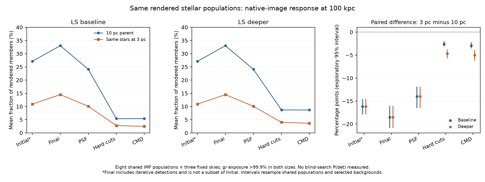

# DR11 search and selection response

On 2026-11-21 the user withdrew the previous review packages pending a new convolved-density edition. The previous readiness reports below refer to historical releases. NERSC retains the frozen source evidence and backup. See the current task ledger in PLAN.md.

## 2026-11-21 — known-system recovery and qualified footprint

The pinned Tan tables, three subsequent project controls and three Euclid systems contribute 101 literature objects. A control is evaluable when its centre lies in a qualified WCS mask and its literature distance modulus is within 16.5–20.75. A spatial recovery requires the ordinary A group anchor and at least one qualifying retained mode within the larger of 2′ and the literature circularized half-light radius. Each mode must pass its source threshold. The distance columns use the same spatial matches.

| Literature sample | All | Evaluable | Spatial A match | Retained A mode within 0.25 mag | Representative A mode within 0.25 mag |
| --- | ---: | ---: | ---: | ---: | ---: |
| All | 101 | 67 | 49 | 40 | 31 |
| Tan strict main sample | 49 | 38 | 36 | 29 | 24 |
| Tan compact appendix | 29 | 15 | 4 | 2 | 2 |
| Tan compact appendix, detected by Tan | 15 | 9 | 4 | 2 | 2 |

Existing C fits from the corresponding qualified production records cover all 49 eligible A spatial matches. A retained C mode is within 0.25 mag for 43, and the highest-TS spatially matched C mode is within 0.25 mag for 37. These are post-search comparisons to literature controls; the tally does not estimate population completeness. [Recovery table and C summary](results/v14/census_comparison/)

Four baseline misses were remeasured at known positions. The table uses the nearest frozen distance grid point, the best fixed-centre score over mask-eligible formal scales within each arm, and the same native masks. Parentheses give the expected on-aperture background. The 0.5-mag experiment changes the catalogue limits while retaining the source images and classifiers.

| Control | Baseline CMD counts (background) | Deeper CMD counts (background) | Nominal fixed-centre score |
| --- | ---: | ---: | ---: |
| DELVE 7 | 11 (2.37) | 14 (2.94) | 3.80 → 4.78 |
| Sextans II | 71 (47.12) | 136 (86.07) | 2.90 → 5.82 |
| Gemini I / DELVE 8 | 13 (3.52) | 15 (2.34) | 3.58 → 6.12 |
| Aquarius IV | 7 (1.04) | 11 (1.70) | 3.31 → 4.80 |

Gemini I changes its best scale from 1′ to 0.5′, so its on/off counts use different apertures. Sextans II uses 4′ in both arms. Gemini I and Sextans II are the clearest controls for a same-depth matched-background test. The fixed-position scores have no blind-search calibration. The four diagnostics do not establish a likelihood-search gain. [Stage counts and mask fractions](results/v14/census_comparison/missed_controls_fixed_diagnostics.csv)

### Local background comparison for the four misses

Random positions came from the same qualified fields and matched the target's usable on/off areas to within 10% at each eligible formal scale. At the nearest frozen distance grid point, the best fixed-centre score across eligible scales was evaluated at baseline and deeper limits. Known cores were excluded from the control on-apertures. The matched controls share overlapping apertures, so the ranks are descriptive and zero counts have finite resolution.

| Control | Centres | Baseline controls at least as high | Deeper controls at least as high | Controls with at least as much paired improvement |
| --- | ---: | ---: | ---: | ---: |
| DELVE 7 | 304 | 0 | 0 | 1 |
| Sextans II | 400 | 4 | 2 | 5 |
| Gemini I / DELVE 8 | 400 | 0 | 0 | 14 |
| Aquarius IV | 400 | 5 | 0 | 12 |

Each target is unusual in its local comparison, including several baseline measurements. This supports a usable colour–magnitude signal at the known positions. The experiment changes photometric limits and selects a scale, with the target position and distance supplied. It does not measure how many region-wide peaks compete with the targets. Test the existing A search with deeper photometry on fixed development and test fields before adding a standalone likelihood search. A likelihood pilot becomes informative if calibrated deeper A still misses objects with demonstrably coherent signals and well-measured backgrounds. Keep the production thresholds frozen. [Fixed-position controls](results/v14/census_comparison/control_null/)

The Galactic Aitoff maps use 512,637 covered NSIDE 256 sample centres from the accepted WCS masks. Their sampled area is 26,890.811 deg²; the formal union remains 26,886.648 deg². The LS panels show observed 10σ gr depths, using the corresponding hemisphere's brick summary converted from 5σ. Survey-wide matched-sky depth and classification comparisons require broader comparator coverage. The unannounced production positions are held on NERSC. [Footprint, depth and known recovery maps](results/v14/qualified_aitoff/)

### Matched LS–PS1 source-depth measurements

On the three native CCD backgrounds, 41,809 PS1 primary positions within the LS mask have unique 0.8″ LS catalogue matches. Using each catalogue's PSF flux uncertainty and dereddened native passbands at a common 10σ, the median paired depth differences are positive.

| CCD background | g pairs | LS − PS1 g (mag) | r pairs | LS − PS1 r (mag) |
| --- | ---: | ---: | ---: | ---: |
| 1 | 858 | +1.57 | 1,639 | +0.64 |
| 2 | 2,415 | +1.33 | 3,234 | +0.79 |
| 3 | 1,418 | +1.44 | 1,963 | +0.89 |

The table uses LS PSF sources and PS1 measurements with S/N between 5 and 20. Requiring the additional PS1 bright i-band point-source proxy shifts the medians by at most 0.03 mag. Across all positional matches, 11,114 pass the frozen LS baseline cuts and 13,632 pass the deeper LS research cuts. Both counts are limited to catalogue matches; sources missed entirely by either catalogue are outside the depth comparison. The map shows supported 5′ cells. These measurements establish local differences in catalogue flux-error depth. The real image-injection comparison and the independent PS1 source-response validation still govern any claim about physical recovery gain. [Matched depth products](results/v14/repeat_full/matched_source_depth/)

The same 10σ convention was applied to matched point-source measurements in two 0.18° radius cones in other census assignments. In the DES DR2 cone, LS minus DES is +0.43 mag in g (821 pairs) and +0.53 mag in r (862 pairs). In the DELVE DR3 cone, LS minus DELVE is −0.15 mag in g (188 pairs) and −0.44 mag in r (177 pairs). The comparison uses the weighted single-exposure PSF magnitude errors published by DES and DELVE, plus the LS fit errors. Each pair shares the LS DECam extinction correction. The catalogues can share exposures, and the differences apply to the selected and matched sources in these two cones. [DES DR2 photometry](https://datalab.noirlab.edu/data-explorer?showTable=des_dr2.main) · [DELVE DR3 photometry](https://datalab.noirlab.edu/data-explorer?showTable=delve_dr3.coadd_objects) · [Five-field comparison](results/v14/repeat_full/decam_matched_depth/local_survey_depth_comparison.png)

### First 10/15 pc paired CCD result

At 100 kpc, the first population and background have verified native images at both 10 and 15 pc. The matched experiment uses the same 293 generated members after a common stamp cut. The cut retains 98.54% of the parent rendered V-proxy light. The blind A search recovers the position and distance at both radii with both photometric limits. At 15 pc the image processing yields nine more final associated detections and 17 more PSF classifications. Three more associated sources pass the baseline selection and five more pass the deeper selection. The one-position comparison holds the rendered stellar population fixed while its placement relative to foreground and neighbouring members changes. It shows a size-dependent source response for this realization. The other five population–background pairs are registered and pending. [Pilot results and common support](results/v14/fifteen_pc/)

## 2026-11-20T10:09Z — final one-time review release accepted

All 6,891 registered R14 fields are terminal: 6,861 complete and 30 without valid gr. The qualified historical ledger has 10,356 records at 10,169 provisional positions. Its represented exposure-mask/projection union is 26,886.647579 deg². This is searched area, not newly imaged or unexplored sky, and not an area with validated physical gain. The frozen frame has 8,981 administrative review units; 161 production units and two weak controls enter the final packet. All original 75 cases remain retained. Necessary C and image evidence covers 226 selected exact-source records, 752 source modes and 13 additional control modes.

Version `v14-final-1` is ready for one formal user review: 163 anonymous units, 1,531 pages, one blank response table and an isolated five-entry ZIP. Held scientific context has 2,493 pages with 2,295 source images, plus a 171-page exact-record known/environment appendix. Every image matches its registered source pixels; all 4,195 PDF pages independently render and pass text/object bounds checks. All 39 anonymous overview sheets and six full-size pages were inspected. These are technical QA checks, not human scientific grades. Identities and context remain held until actual user responses are sealed. The original release_v2 hash is unchanged.

Assembly 61636677 completed in 28:28; private archive 61638492 completed in 33 seconds. HOME-copy attempt 61639551 stopped before writing because compute-node myquota is unavailable. A fresh actual login-node quota observation and a 256 MiB reserve support retry 61639687, which completed in 19 seconds. Its 21 files (1,332,130,160 bytes) are hash-verified in the personal project. The local anonymous ZIP is identical, and the local held PDFs/metadata match the private archive contents. [Release hashes and QA](results/v14/human_review/final_review_release.json) and the [review guide](docs/FINAL_REVIEW_GUIDE.md) define the handoff. The anonymous ZIP contains no identity key.

The scientific limits remain explicit. Formal paired-depth tests give spatial recovery 39/144 → 49/144, highest-mode correct distance 31 → 43, retained correct distance 35 → 47, and usable members 1,170 → 1,944. The +6.94 percentage-point depth difference and crossed-resampling sensitivity interval [0, 14.58] pp do not pass the frozen >10 pp/positive-lower-bound screen. Production retains A baseline. Physical PS1 transfer, a true-V/full-spatial selection function, 15 pc and continuous-distance contours, and population abundance remain unsupported. No new system has independent confirmation or automatic promotion. Further physical calibration is a separately scoped next stage; no manuscript body has been started.

## 2026-11-20T08:37Z — actual closed production and complete formal paired-depth result

All6891registered scans are terminal (6861complete,30zero-valid-gr). Historical qualified records10356at10169provisional positions are represented by a26886.647579deg² working-mask union; gross27031.731142deg² loses145.083563deg²to overlap. Ordinary scans including non-production regions cover28812.390012deg²in the same representation. These are exposure-mask/projection areas, not continuous-native-pixel accuracy or newly imaged/unexplored/gain area. Unambiguous qualified intersections areDES4791.806758,DELVE10894.403654,PS18565.827305andunassigned/masked2624.873374deg², with9.736488deg²ofcensus-boundary ambiguity retained. North reuses older imaging; PS1assignment and unassigned labels do not establish new discovery space. Physical detectability-gain area remains unmeasured/null.

The final administrative frame/draw is frozen:8981units,103certainty+58stratified SRSWORaudit=161selected units. Original75remain separate retained identities (17also satisfy regional priority);28additional regional priorities and58audit units complete the set. Two weak known controls remain separate. Necessary same-qualified-record C is complete for226selected records, including24new records/32modes. New render work is523modes in150records after existing exact-source caches; no human grade, L1promotion or final package is claimed before all gates pass.

| Formal A endpoint /144background applications | Baseline | Deeper |
|---|---:|---:|
| Spatial |39|49|
| Highest blind distance within0.25mag |31|43|
| Any retained compatible distance |35|47|
| Usable hard-selected members, summed |1170|1944|

This pair uses the same48potential populations in three selected skies, six physical cells, the full formal grid/mask and original development-budget cuts6.137901/7.520695. Eleven pairs are deeper-only and one baseline-only:spatial delta+6.944pp,crossed shared-block/sky sensitivity[0,14.583]pp. The simultaneous conservative fixed-sky bound is[-60.239,66.681]pp; it retains limited Monte Carlo information and zero-discordance uncertainty. **No cell meets the registered meaningful-positive-gain screen.** Keep baseline production; this does not demonstrate that LS has no gain over PS1.

Background spatial counts are16→18,11→16,12→15(each48applications). Bright target-proxy cells:3pc5/24→6/24,10pc22→23,30pc12→18. Faint10pc0→2;faint3/30pc0→0. These cells contain8independent potential populations reused across backgrounds. Actual realized luminosities differ between radii; do not call the raw radius contrast a pure size effect. Zero bootstrap width where no discordance was observed is not zero uncertainty. The three unchanged backgrounds contain0/0/0baseline groups and2/1/1deeper groups; none matches any of the144truth positions. They are3reused empirical backgrounds, not144independent FPRtrials.

The figures and paired tables are actual accepted results, not simulations of a catalogue pipeline. Original native144/legacy288stage measurements and their Cdiagnostics remain separate from this formal A-only replay. Formal C is not rerun or borrowed; finite rendered light/stamps, V-band proxy, selected skies, unresolved physicalPS1response and unknown human attrition prevent a global physical selection function,50%contour or abundance bound. Existing matched-native Cfollow-up fits40/64spatial cases and the retained stability proxy passes40/60; those are legacy-procedure diagnostics, not the formal C endpoint or independent discoveries. No new system is confirmed, and0706continues L0with weak independent BASS support.

## 2026-11-20T07:21Z — ordinary production benchmark association

The actual20-object registered roster has17centres inside qualified represented masks;15targets lie within the formal main-distance interval and12meet both conditions. Eight of those12have an ordinary qualified group-anchor spatial match, seven retain a distance mode within0.25mag, four have a highest blind representative within0.25mag. Keep all222nearby-mode/source links. This is a descriptive fixed-roster crosscheck, not population completeness or independent validation. DELVE3/4/5realgr control recoveries are separate from their exclusion from this qualified mask; no coverage failure is inferred. Four covered/in-range non-matches are DELVE7,SextansII,GeminiI/DELVE8,AquariusIV; Coma has spatial/broader-distance support but no retained strict0.25mag mode. No search or threshold change follows this audit.

## 2026-11-20 14:57 CST — accepted evidence and paired formal-depth pilot

Atlas/efficiency tail61629183 completes22:49; current atlas binds6861R14rasters and all four scientific PNGs pass full-raster layout inspection. Sidecar captions distinguish coarse/all-scope coverage, machine contexts and legacy catalogue/native pilot curves from qualified area, human grades and physicalPS1gain.

New original-source renderer readiness61631306/61631657 accepts2records/5saved modes/25PNG with exact config/template/member/output checks; identity/context stay private. Original75/226modes and weakDELVE4/5controls remain preserved. Final sample/draw/required selected C/material/page/privacy QA remain gated by720tile acceptance.

Formal deeper pilot61629992→61630419 accepts18paired cases/6potential populations/3skies: spatial5→6,highestDMcorrect5→5,retainedcorrect5→6,hardmembers132→230. Original fixed development cuts6.137901/7.520695 and common formal masks/grid verified. Three blank-core qualifying group counts are0/0/0baseline and2/1/1deeper; none match the18truth positions. These are3reused backgrounds, not18independent null experiments or a final depth-gain result. Fullsame144replay61630564 and proof61630992are queued; original baseline/legacydata and physicalPS1limitations stay separate.

## 2026-11-20 13:28 CST — closed-source production checkpoint

Existing post61627306 completes7:42:10356qualified historical+R14records/10169provisional positions,all75identities retained. Exact Ccoverage8704records/20362seeds complete;1652records/2546seeds unattempted, to be completed when required by final selection. R14increment alone9070records/9007associations is separately retained. Local registry/ledger/Csource hashes pass.

Current8345mask inventory has7511qualified/824development/4knowncontrols/2regression/4unqualified;306source-bound analysis-role overrides. Gross summed masks are not union area. Current8094b69a21510971registration feeds existing61626647/61626690/61626692. Finalframe61628955waits for actual area; source-bound region/history guards pass all10356records/10regions/2544historical blind modes, and same pending owner is released. No final draw, user grade, physical-gain footprint or review release yet.

## 2026-11-20 — final-review material preparation checkpoint

Original75saved-source evidence is fully prepared and verified:75cases,226modes and1223retainedPNGintegrity checks, unchanged original release hashes; local allowlisted copy independently hash/PIL-verified. DELVE4/5original blind controls add13saved modes/65PNGs with no missing expected images and sampled full-raster QA. All remain private preparations, not user classifications or current-policy recovery measurements. Final production/common-clock area/universe/new selected-case and full package QA remain open; no intermediate human grading is requested.

## 2026-11-20T04:19Z — outside C accepted; common-clock area pending

The remaining outside-census follow-up is now accepted:979source groups and3102retained modes across16shards(503main/2599extension). All selected fits complete, with exact discovery/configuration/member binding; synchronized local source hashes match. These are hypotheses on production records, not new physical systems, and do not by themselves change L0 status or establish independent confirmation.

The next numerical release is the common-clock historical/global catalogue and represented-mask union. All8341ordinary mask geometries are cached; their final qualification and720tile union are not yet accepted. Do not replace final production area with the old18,173.913deg²subset or the24,481.308summedR14area. Physically demonstrated gain area remains unquantified. The144native LS experiment, PS1response failure and finite-light/three-background limits remain unchanged.

## 2026-11-20T03:51Z — native PS1 preflight boundary

Native PS1 mean-signal61625458 completes8:21/operator0, but the registered bright-unit check fails (only r passes both bounds). Bright grizy magnitude residuals are +0.163,−0.049,+0.089,+0.066,−0.002mag. Read-only61625886 completes42s: finite-patch added/declared flux is conserved to1.1e−6 across20band/calibrator combinations; griz centroids are approximately−0.5pixel in each axis. The discrepancy is therefore not a gross nanomaggy/exposure or asinh-flux scaling loss. Finite/global PSF representation, pixel-coordinate convention and local aperture/shape response remain unresolved; do not fit a compensating offset or promote these probes into physical PS1 trials. Stop parameter/recipe tuning in this technical branch; retain its measured boundary while closing production/evidence.

## 2026-11-20T03:39Z — scientific scope while final integration closes

Registered search execution is complete:6861successful scans plus30zero-valid-gr fields account for6891/6891;174registered retries accepted. Summed R14owned area24481.307990deg² remains distinct from the final historical union and from an empirically demonstrated gain footprint. Outside C and the common-clock final production release are unfinished; no new system is confirmed and no human grade is filled.

The official archived PS1 operator produces real five-band blank measurements (61622347); same-image comparisons are descriptive, not a validated physical response. A bounded four-point finite-kernel mean-signal probe is now testing pixel/unit consistency. First attempt61625226 fails before photometry because a linear FITS file had an empty primary image; retry61625458 corrects the container. It neither adds invented Poisson noise to calibrated coadd units nor counts as a satellite trial. Full PSF/field dependence, photon/covariance response, canonical primary selection, faint-blue reference truth and cross-sky validation remain unresolved. The [official stack documentation](https://outerspace.stsci.edu/spaces/PANSTARRS/pages/298812339/PS1%2BStack%2BImages) distinguishes pixel-frame and catalogue calibration; a successful operator is not DR2 recipe equivalence.

The accepted144native realizations,48sharedIMF populations/three skies, finite-light checks and fixed-population size losses remain the actual physical evidence. There is no validated LS–PS1 physical ΔPdet, global50%contour or abundance inference. Priority remains final production/evidence and bounded response validation, not expansion of the scientific grid or manuscript writing.

## 2026-11-20T02:24Z — all 6,891 registered search fields are terminal

The final manifest audit accepts **6,861 completed scans and 30 zero-valid-gr fields**. All 174 registered retries are accepted; no uncovered retry remains. The 30 unusable fields have zero valid mask area. R14 summed owned area is **24,481.307990 deg²**; this is not the final historical union or a physical-gain area. The source-bound terminal proof is `results/v14/progress_ab20261120/terminal_acceptance.json`.

Outside-census regional summaries/C and the already registered final aggregation jobs continue. Final production/source clocks, mask union, selected C/evidence, probability sampling and anonymity/page QA are not yet frozen. The old 75 remain unchanged; no intermediate human grades are requested.

Real PS1 g processing succeeds (61621698; 4,057 measured sources, 582 PSF stars). The first same-cell comparison is descriptive, not physical completeness. The native g FITS `STK_ID=4297531` distinguishes it from other per-band image IDs present in the same-skycell catalogue rows. Corrected exact-image comparison 61622359 completes, with median native-minus-DR2 magnitude −0.00480 over 2,146 quality-g matches. Five-band native operator 61622347 completes in 8:09 (operator return 0; 451 s) after actual-header identity binding. Its first comparison 61622975 records 11,381 native rows per band and 3,944 matched gri reference rows, of which 3,937 link to the same native object ID. The reference-conditional SNR/morphology comparison is descriptive, not a physical response. DR2 operator equivalence, primary/canonical rows, native-only sources, faint-blue selection and other backgrounds remain unvalidated. No zero-point fit or discovery tuning was performed.

Mandatory old-75 preparation pilot 61622229 completes all 22 retained modes of the largest mode-count case in 7:25, without refitting. Preparation stays private. A separate geometry audit finds 96/226 hypotheses exceed the central stamp cap; add full two-half-light-radius gr views and unweighted usable-area radial profiles while retaining native central detail. Largest-extent pilot 61622790 failed on NumPy boolean histogram weights; float conversion passes the targeted smoke, and retry 61623142 completes in 4:07. Its full two-rh-square gr mosaics have finite coverage 1.0 in each band and pass sampled full-raster inspection. Remaining 74 mandatory cases are registered in ten resource packs (61623753), not counted complete. Final PDF/ZIP release still waits for every whole-project gate.

## 2026-11-20T02:00Z — historical C accepted; whole search has 38 fields remaining

- Latest manifest: **6,824 completed + 29 zero-valid-gr = 6,853/6,891 terminal fields**; 38 remain in the original outside-census owner. All 174 registered retries are accepted; no uncovered retry is required. R14 summed owned mask area is 24,473.889020 deg², not the final historical union or physical-gain area. Outside-extension scans are terminal; their C array is advancing.
- Historical priority backfill is complete: **99 fields / 269 qualified records / 467 original modes**, with original selection/template, discovery-seed and saved-membership proofs. Jobs 61617692 and 61617693 are terminal successes. Refresh 61619421/61619423 is accepted; all 722 catalogue input hashes match the synchronized files.
- Interim integrated accounting remains **9,576 qualified records / 9,403 provisional positions**, preserving all 75 frozen identities. Exact-source C is now complete for **7,924 records / 17,853 required seeds**. Remaining 1,652 records / 2,546 seeds are unattempted low-priority records, not nondetections. This clock precedes final outside-census integration.
- Saved-context renderer pilots 61618104 and 61618873 reconstruct the stored likelihood without refitting: one zero-richness and one positive-membership mode, six inspected rasters, complete native gr and zero missing expected contributor stamps. Coordinate/probability/score context stays private for phase two. The plot-only isochrone marker change avoids a false evolutionary-phase connection. Final sample, images and PDF/ZIP privacy/page QA are still pending.
- Official IPP core **build succeeds** in 61620144. Serial Ohana library generation resolves the observed parallel header race; compiler-driver `-fcommon` preserves legacy tentative-symbol semantics in consumers. No numerical photometry source was patched. Acquired 20 actual grizy science/variance/mask/exposure products (676,002,240 bytes) and 6,950 same-cell DR2 reference rows in 61621032. All raw products remain NERSC. The first native g-band technical preflight 61621526 is submitted, not complete; five-band DR2 operator equivalence and physical PS1 response remain unvalidated.
- Original 144 physical realizations, paired-radius and faint-light results retain their finite-light/shared-population/three-sky limits. No detector/threshold change, new physical grid, candidate promotion, human grades, abundance claim or manuscript. The final whole-project human package is withheld until every release gate passes.

## 2026-11-20T00:23Z — interim unified production and C accounting

The completed-source refresh is accepted: catalogue61616596(COMPLETED4:08), corrected ledger61617103(COMPLETED4:27), all425input hashes synchronized. Qualified historical plus R14 discovery records now number**9576**, provisionally associated into**9403positions**; original75identities remain intact. R14alone contributes8290records,8241provisional associations and6855records with an available same-source fit. These are source/sample accounting counts, not new systems or final independent human-review units.

**7655records/17386required seeds** are fully C-complete;**1921records/3013seeds** are unattempted. Applying the existing compact/high-score follow-up rule finds no missing R14priority record, but269historical priority records still need their own source/configuration handling. Do not borrow an alternate record's fit to erase these gaps. Low-priority missingC is unknown. Current scans:6566complete+29zero-valid-gr/6891,296remain;24381.922789summedR14owneddeg²,not final history union or gain area.

Historical priority follow-up:99fields/467original retained modes are registered with exact original selection/template hashes. Pilot61617524completed54s,5records/6modes accepted. Remaining97fields/342modes are in61617692;one119-mode field in61617693. These submitted batches do not yet change the accepted7655/17386global coverage clock. No new discovery, quality grade or independent confirmation follows from C fitting.

The initial ledger safely failed because its global SouthDELVE/DES status counts lagged actual regional comparisons(3275vs4132;1410vs1482). The repair checks current per-cohort comparison counts with exact frozen-cut agreement, retaining the older clock separately. Search parameters and thresholds did not change.

Private score-hidden rendering now succeeds on one previously exposed case: unweighted measured-source positions/CMD errors/nativegr/exposure, neutral mode ordering and full-rasterQA. No final sample, complete evidence or anonymousPDF/ZIP is released. All75old bytes/identities and blank responses remain preserved.

The bounded PS1library build reaches an invalid generatedOhana header after documented warning/common-symbol compatibility flags. There is no accepted psphot/image-response measurement. Physical LS-minus-PS1 gain remains unresolved. Existing native144, fixed-population size loss and faint-light sensitivity retain their stated finite-light/three-sky limits; no new parameter grid or manuscript is started.

## 2026-11-19T23:27Z — fixed-population size experiment: native source separation is limiting

All **24 native cases /48 paired-depth rows** pass (eight existing bright10pc IMF populations, each shrunk to3pc on three original skies). Intrinsic member identities/light are unchanged; original144products are immutable. Registered source/producer/configuration and native proof hashes pass. Jobs61608931all five packs COMPLETED; stage61610213COMPLETED1:57. This experiment measures catalogue stages, not a new blind-search Pdet.

| Stage, counts across24paired native cases | 10pc parent | Same populations at3pc |
|---|---:|---:|
| Rendered input members |7113|7113|
| Valid gr exposure |7106|7110|
| Initial novel-source association |1926|778|
| Final novel-source association |2347|1032|
| TYPE=PSF |1709|719|
| Baseline hard selection |384|197|
| Baseline truth-DM CMD |384|176|
| Deeper hard selection |616|284|
| Deeper truth-DM CMD |613|258|

Initial/final are distinct pipeline products; final includes iterative detections. Counts reuse shared populations across backgrounds. Equal-weight realization/background mean final-member fraction drops33.04%→14.49%: paired difference−18.55percentage points, exploratory crossed-bootstrap95%[−20.89,−16.07]. Hard-member mean-fraction differences are−2.63points baseline [−3.13,−1.98] and−4.69deeper [−5.70,−3.75]. These intervals describe eight shared populations/three selected skies, not broad-sky or population completeness.

**Association-artifact check61613306 COMPLETED/26s:** maximum-cardinality association at0.8arcsec reproduces every greedy final/PSF/hard count exactly. At1.6arcsec, final counts become2380/1045, while both arms' hard counts remain384/197and616/284. Independent catalogue-minus-blank counts inside3true half-light radii drop2073→733. The member-neighbor fraction within0.8arcsec grows12.66%→62.91%; blank-neighbor fractions remain around1–3.4% without a consistent increase. Thus matching tolerance/greedy ordering does not explain the loss. Shrinking substantially reduces separable catalogue components before PSF/CMD selection, consistent with blending/source-separation limits. This is an inference from stage and geometry evidence; local coverage/extinction/foreground blends and changed source photon pixels remain part of the treatment.

**Decision:** keep the production detector/threshold/kernel frozen. Further small-kernel or ranking changes cannot recreate individually missing catalogue members. Use this result to delimit the compact catalogue route; do not relabel these finite-rendered-light tests as full spatial/trueV completeness. The separate faint-light draw34 changes one baseline crossing; it is not a universal correction. No15pc/continuous-distance selection function or physicalPS1 gain is established.

Sources: results/v14/paired_radius/full_stage_acceptance.json,stage_comparison.csv,association_acceptance.json,association_summary.csv,core_source_summary.csv and figure_manifest.json. Full-raster layout QA passes; all per-star/images remainNERSC.

Production checkpoint **w23:20Z:6545/6891complete+29zero-valid-gr**,317remaining,24375.34227237654summed R14 owneddeg²,174registered retries accepted/zero uncovered. This is not a final historical union or gain area. Newly accepted C shards include timeout-q03 632modes/406source groups and OOM-m01 433/118; both exact source/seed/membership audits pass. Remaining production and common-clock integration gates still apply.

Official PS1 IPP source151700998bytes is acquired and verified (officialMD5 and SHA256 in references/ps1_ipp_source_manifest.json). First core probe61613456reachesconfigure but lacksCFITSIO/floatFFTW development interfaces.61613934builds bundledCFITSIO; runtime-only vendorFFTW still lacks pkg-config/header support. 61614223also builds bundled floatFFTW3.0.1but psLib compilation hits missing optionalMySQL mysql_com.h. 61614542disables the optional database and reaches later compilation, blocked on bundledOhana/kapa.h. No binary/image response is accepted; no database suite is installed. Source availability/build attempts are not PS1 DR2 catalogue reproduction or a validated response. The condition-mismatched COSMOS response remains unsuitable for universal physical transfer. [Official source](https://ipp.ifa.hawaii.edu/),[pipeline stages](https://outerspace.stsci.edu/spaces/PANSTARRS/pages/298812327/PS1%2BImage%2BProcessing%2BPipeline).

Final one-time human delivery remains **not ready**: complete full search, qualified historical/common-clock roster/areas/identities, necessary C, selected saved-membership-bound evidence, probability sampling and anonymity/page QA. Original75files and blank grades are preserved; no automatic promotion or manuscript writing.

## 2026-11-19T22:25Z — faint-light perturbation measured; production continues

- v22:19Z: **6529/6891 complete +29 zero-valid-gr terminals**, **24361.03503858024 summed R14 owned deg²**,333 fields remain;174scan retries accepted,zero uncovered. These are not final historical union or physical-gain areas. **61592117_2 COMPLETED/13:14**,784retained modes/403source groups pass exact source/seed/membership checks; remaining registered C owners still require acceptance.
- Faint-light native3/3 and six paired-depth measurements pass. Same278bright members; add4975omitted faint members inside the same3.1arcmin footprint, rendering95.90%fullIMF V-proxy light (4.10%outer light remains). Original144 and expanded-bright controls are unchanged. Native jobs61605249/61606497 and measurement61606498 are terminal successes.
- Baseline spatial/highest-correct recovery changes **2/3→1/3**; deeper spatial stays **3/3**,highest-correct2/3→2/3,retained-correct2/3→3/3. Fixed bright-member hard counts sum58→57 and88→88. These are three backgrounds of one selected IMF realization, not independent populations or a population-rate estimate. New faint positions and changed source photon pixels remain coupled to the perturbation.
- Saved-peak audit resolves the baseline loss in background2: matching raw and grouped A scores both6.504599→5.488268 versus fixedcut5.789099. The peak remains below cut, so this is not a peak-merging failure. Do not tune the threshold. Full faint-light treatment and finite footprint are material near a decision boundary; no universal correction or proof that faint light alone causes the change. Figure/aggregate provenance and full-raster QA pass. See results/v14/faint_light/.
- The same21registered paired-radius native cases transferred from wholly pending regular61604174 to **61608931** in bounded4/5-case debug packs after pilot resource proof and actual QOS check (2running/5submitted). Old pending owner retired only after new ownership and collector dependency verified; no running task or scientific config changed. **61604183** awaits the new owner. Native success remains distinct from all24stage acceptance.
- PhysicalPS1 transfer remains unvalidated; no physicalLS−PS1 gain, full-spatial luminosity completeness or population inference. Preserve original75 and blank grades; finish common-clock production/area/required C/selected evidence/sampling/privacy-page QA before one final human release. No manuscript writing.

## 2026-11-19T21:55Z — latest Pro review: omitted faint-star light calibration

Follow-up21:58Z: **61605249 COMPLETED/5:24**, native DR11.1.0 processing185.2s; registered native catalogue/truth/exposure/initial-detection hashes pass. Remaining two fixed backgrounds **61606497**, three-site paired blind/stage measurements **61606498** are submitted, not complete. The input contains5253stars (278unchanged bright+4975faint) and95.90%full V-proxy light;4.10%spatial-tail light remains outside. Native completion is not a recovery result.

Fully read the newest Pro assessment68fa1336 (19Nov21:56CST), following437262c6. Its144-trial and area/C counts predate accepted current results; retain newer measured clocks. The additional actionable calibration is unresolved faint IMF light. Existing outer-bright test addresses a different omission.

Register draw34 on all three original skies: preserve all278 accepted extended bright stars/positions, add4975 previously magnitude-ineligible members within the same3.1arcmin native footprint. Their previously unassigned positions use a declared conditional seed. Rendered light rises from23.565137 to25.191107 of fullIMF26.267464 in V-proxy units;1.076357 remains outside (4.10%). Pilot61605249 is running, not accepted. Measure unchanged bright-member associations separately so thousands of faint truth positions cannot steal bright associations; retain all-truth counts with their different denominator. Then compare actual blind outcomes on the same measured-catalogue workflow. This selected one-population experiment is not a global correction, pure diffuse-light effect or calibratedV completeness. Original144 and frozen75 remain unchanged. Current final-production and physicalPS1 gates still apply.

## 2026-11-19T21:44Z — South DELVE primary C complete

**61470252_5 COMPLETED/20:01**,1097/1097 retained modes in575source groups pass exact source/seed/membership verification. Its59preserved old fits (52positiveTS) exactly match restarted numerical values and membership hashes. Together with shard04,all311available archived fits match. This closes the original South DELVE4/5 numerical restarts; original2/3 still await registered61592117. Final source-clock integration and selected image evidence remain pending.

## 2026-11-19T21:40Z — native radius pairing registered; further C shards accepted

The u21:33Z audit has **6521/6891 complete +29 zero-valid-gr terminals**, **24357.978722993823 summed R14 owned deg²**;341 fields remain. All174 registered scan retries are accepted,zero uncovered. Existing scan/C owners remain authoritative; queued work is not complete. This area is neither the final historical union nor a measured-gain footprint.

Six additional source-bound C shards pass exact seed/group/membership checks: South DELVE04 996modes/501groups and07 1297/590; DELVE-extension07 98/34; OOM-m00 217/57; OOM-n03 384/116; timeout-p06 150/53. Their3142 modes/1351 source groups are not independent physical systems or final global C coverage. Extension07 explicitly uses a legacy provenance audit: run-start implementation/config/render policy remain unknown. On shard04,252 preserved full-render fits (208 positive TS) exactly match restarted numerical values and membership hashes. Selected final diagnostics remain mandatory.

To distinguish native size-response loss from the observed IMF-luminosity confound, all eight existing100kpc/10pc/target−3 populations were registered for shrinking to3pc on the same three skies, holding rendered member identities and intrinsic light fixed. Original144 results are immutable. **61602484 completed**,three native cases/six paired-depth stage rows pass, reproducing original exposure/final/PSF/hard counts. Remaining21 native cases are submitted as **61604174**, with full stage collector **61604183**. These are image-to-catalogue stage diagnostics, without blind search or a new Pdet measurement; retain finite-list, local dust/coverage/blend/noise limits. See [registered protocol](configs/v14_paired_radius/protocol.yaml) and results/v14/paired_radius/. Pilot outcomes do not select the remaining cases.

Physical PS1 transfer remains unvalidated because the independently labelled COSMOS reference has different gr observing conditions. No physical LS−PS1 increment, radius-only completeness,50% contour or population inference is asserted. Preserve the original75 and blank grades. Final common-clock production/area/C integration, saved-membership-bound selected evidence, sampling and anonymity/page QA are still required before one human review. No manuscript writing.

## 2026-11-19T20:30Z — production-scale C acceptance and unchanged scan continuation

- s20:23Z manifests: **6459/6891 complete +29 zero-valid-gr terminals**, **24335.501543209873 summed R14 owned deg²**,403 fields remaining. All174 registered scan retries accepted,zero uncovered. Eight original scan batches were running; retain their original owners/frozen search policy. These are not final historical/gain areas.
- **61591390_2 COMPLETED/5:51:** exact98 retained modes/34 source groups,98 complete fits,98 verified membership references to67 distinct immutable artifacts. **61470252_6 COMPLETED/11:11:**582 retained modes/328source groups,582complete fits,560distinct membership artifacts. Both pass exact input/config/implementation/whole-source-seed and membership checks, with diagnostics explicitly pending. These are two production-source C shards, not counts of unique physical systems or a new independent discovery experiment.
- After these full-shard proofs, original slow full-render owners61470252_4/5 were requeued once **under the same job IDs** into the verified numerical-first path. Selected996/1097 modes remain unchanged. Old partial tables/images were atomically archived in the corresponding *_full_render_attempt0 directories and old logs copied; no science file was deleted. Both global release jobs retain explicit dependencies on the original internal owners. New source/provenance/evidence acceptance is still required after restart.
- Initial requeuehold4 was disabled with Requeue=0; owner opt-in Requeue=1 succeeded. A site-specific held reason job_requeued_in_held_state then required correcting the narrow archive-transition check; pending/priority0/restart1 was verified before archival and release. Both owners are released, with no technical hold left. Failed attempt and recovery metadata are preserved. These are execution transitions, not astrophysical failures.
- A bounded in-place shared-queue scan resource attempt was rejected by NERSC policy; readback confirms original regular/32CPU/104G resources unchanged. The inspected actual spooled batch uses8workers/12500MiB steps, distinct from the newer on-disk script. Its executed source is preserved. A separate shared scheduling **test-only** request submitted no job; its provisional late estimate was not used to promise a start. Stop this optional resource branch and follow existing regular owners.
- Original75/273pages and blank grades remain preserved. Final common-clock production/area/identity integration, necessary C, final selected saved-membership-bound diagnostics, probability sampling and privacy/page QA remain outstanding. All144 native LS trials and physical PS1 transfer limits are unchanged; no candidate promotion, intermediate human grading or manuscript writing.

## 2026-11-19T19:50Z — measured C rendering bottleneck; numerical fits preserved

- Running-field timestamp proxies show tens of seconds per diagnostic stage: South DELVE shard4 environment-after-candidate median35s/native-image-after-environment29.5s; shard5 medians42.5s/22.5s. These are concurrent file-timestamp phase proxies, not CPU profiles or independent wall-clock totals. Plotting also loads the full raw-template peak table, which C numerical likelihoods do not use.
- **61593937 COMPLETED/5:06:** two existing retained modes on the same actual field were fitted with immediate and deferred diagnostics. All34 common scientific columns, source IDs and probability arrays agree exactly; TS3.3303302030738386 and0.0. The unchanged fit/conversion/membership/rendering function AST audit and point-process source hash accompany the result. Ordered warm-cache elapsed122.156s versus27.492s is a local equivalence/timing pilot, not a full-cohort speedup measurement or extra recovery experiment.
- New R14 C Python processes now defer plots and plot-only raw-peak I/O. The numerical C/selection/mode grids remain unchanged. Provenance records renderer implementation/config hashes and the rendering policy. Deferred rows have image_pending=True, diagnostics_deferred=True, unknown missed-image counts and no generated-image claim. Final selected cases must render from saved verified membership and pass all evidence/privacy/page gates. The general review API and non-R14 defaults retain immediate rendering; explicit LS_SAT_DEFER_C_DIAGNOSTICS=0 requests immediate rendering in the R14 runner.
- Already-running C processes retain their loaded full-render implementation; none was canceled or duplicated. Existing South DELVE array cap2→4 clears the actual two-active/two-waiting task limit. DELVE-extension had only7 visible and all previous original tasks terminal, yet a task-limit reason; cap2→3 allowed reevaluation and7 is now running. Both changes preserve existing owners/resources/science; no scheduler-root-cause or throughput claim. At19:48Z three original C shards run, remaining registered C/413 scan fields are pending under their existing owners. Last terminal scan checkpoint remains r6449+29/6891 with zero uncovered scan retries.
- All144 native/288 matched-policy arms, formal baseline replay, old mask snapshot, original75 and blank grades remain intact. Final production/common-clock union/required C/selected evidence/sampling/anonymity remain gates. No intermediate human review or automatic candidate upgrade.

## 2026-11-19T19:27Z — bounded review geometry on the existing snapshot

The observed5arcmin friends-of-friends diagnostic chained87 provisional positions and could span over40arcmin. A sky-only greedy complete-link diagnostic now requires every pair in an administrative packet to be within5arcmin, ordered only by immutable input position ID. On the unchanged7994-record/7822-position snapshot it yields6881 packets, largest13 positions, maximum pairwise span4.995860arcmin. All7822 positions and75 frozen identities remain; original source/mode links and grades are unchanged. RA-wrap, pole, chain and input-order regression cases pass. This is a prospective grouping diagnostic, not the final candidate universe, a physical-system identification or a claim of independent sky trials. Nearby cases can remain in different packets; retain their adjacency and never reject sampled cases afterwards for proximity. Freeze the final units and inclusion probabilities only after production convergence.

## 2026-11-19T19:10Z — accepted area snapshot and PS1 condition boundary

- Follow-up19:16Z: full regional accounting75 tasks identifies11 failed C attempts; all now have a registered live/completed follow-up (scheduler coverage, not scientific acceptance). Newly confirmed South DELVE original2/3 TIMEOUT are covered by **61592117** (784/632 identical retained seeds,403/406groups,128G/four hours). Both global release jobs wait for it. Regional75-task/11-failure audit has zero uncovered failures. Scan r19:15Z is6449complete+29zero-valid-gr/6891,174scan retries accepted,zero uncovered; summed R14 owned area24330.253906249996deg².413 fields remain, covered by the original pending arrays; outside-extension111 completed1:06:06. Queued work is not a completed final sample.

- Search audit q19:02Z: **6447/6891 complete +29 no-valid-gr terminals**, all terminal masks have zero positive valid area; **24329.532515432093 summed R14 owned deg²**. All174 registered scan-retry fields accepted, zero live-covered or uncovered retry gaps. Remaining415 registered fields still require terminal accounting; remaining original outside-census arrays are queued/running. This is not a final historical union or a measured-gain footprint.
- Accepted immutable historical working-mask snapshot:6269 ordinary completed masks, excluding four known controls.720-tile union QA passes: **25181.084427368576deg² all ordinary scans**, **18173.912656795765deg² source-clock-qualified production**. Removed overlap183.555661364906 and138.297860178809deg² respectively. The qualified subset contains4220 records;1734 other completed masks await matching qualified source rosters,313 development/2 regression records remain separately accounted. Zero-peak fields are retained. Exact represented WCS working-cell union is neither continuous native-pixel area nor final production area. Census-boundary ambiguity is8.702298/4.426326deg²; labelled overlapping unions must not be summed as disjoint areas. All6891/common-clock final geometry is still required.
- PS1 conditions61589109 completed and passed four-field acquisition, duplicate/sentinel accounting and12 Jy/AB unit checks:82235 valid stack positions,517 split-primary rows discarded,11 invalid coordinates. Observed m22–23/3–20arcmin source-error g m5 medians are23.059/23.434/23.352 in the three physical backgrounds versus23.989 in the COSMOS local control; r23.383/23.417/23.286 versus23.952, while i is closer. These source-selected formal-noise/seeing distributions are not completeness or independent aperture-noise calibration. Their mismatch prevents unvalidated universal transport of the independent reference response; physical PS1 Pdet and physical LS−PS1 increment remain unaccepted, not zero. Preserve failed duplicate-guard61586412 and coordinate-sentinel61587648 attempts; canonical first-row objID policy retained, corrupted DR2 bestDetection unused. See INDEPENDENT_REFERENCE_AUDIT.md and aggregate acceptance/figure QA.
- C actual terminal failures remain explicit: DELVE-extension6 TIMEOUT registered61590980; smallest OOM-retry2 hit its29minute debug walltime without whole-shard provenance, registered regular128G/four-hour fallback **61591390**,98 identical retained seeds/34groups. Existing61584021 other shards and61585731 remain registered; both global release dependencies include the new fallback. Original partial products remain untouched.21 pending C tasks already have128G/four hours; resource changes do not change discovery/C science. Existing two scan arrays now cap6 rather than3 after actual task-limit evidence; pending Priority is not a failure or measured throughput gain.
- All144 native CCD products/288 legacy matched-policy arms and formal baseline144 replay remain accepted. Formal baseline39 spatial/31 highest-distance-correct/35 retained-correct; legacy matched baseline40/deeper64 is a separate policy experiment. No new physical PS1 claim, radius-only interpretation,50% contour or population inference. Blank matches were absent at the three reused sites/two arms, not288 independent FPR trials.
- Final whole-project human release remains false. Preserve original75/273pages and hashes, blank grades; finish terminal production/common-clock source+area+identity/necessary same-record C, selected images, probability sampling and privacy/page QA before one user review. New identity-bearing context/key/crosswalk artifacts stay private until sealed first-stage responses; prior public exposure of original75 remains flagged. No intermediate grading, automatic candidate promotion or manuscript writing.

## 2026-11-19T17:42Z — independent-reference results; production still closing

- n17:29Z actual manifests: **6257/6891 complete**,29 zero-valid-gr terminals; **24170.75825424382 summed R14 owned deg²**. Registered retries171 accepted,3 live-covered,0 uncovered. This remains distinct from historical union, candidate clocks and measured-gain area.
- Independent native PS1-image reference experiments completed:61584655→61584300 (24images,0.687282deg²,2792 labelled stars/212 faint blue) and61585005→61585006 (96images,**2.132757deg²,6800 stars/539 faint blue**,275 faint-blue held-out). Expanded actual coverage is smaller than the nominal1.6degree box. All labels, cuts and source-ID fold rules were preserved; this is exploratory same-field validation, not a new-sky holdout.
- Expanded ordinary LS blue PSF proxies g₀23–23.5:193/502 resolved/SED-galaxy labels,52 stellar,257unknown; g₀23.5–24:583/1155galaxy labels,37stellar,535unknown. Never force unknowns into either class or interpret these as all-sky purity.21 estimator cells/5 LS-blue cells have count support; conservative95% per-cell proxy-versus-stellar difference bounds in all five blue cells include zero. No statistically established universal correction is inferred.
- Native HSC observed and corrected LS magnitudes/colours remain distinct. Physical PS1 transfer still fails the full validation gate: label/IR selection, bandpass/error mapping, conditions and compact-system crowding remain limits. Neither isolated-source curves nor their count intervals establish physical LS−PS1 ΔPdet. See [independent audit](docs/INDEPENDENT_REFERENCE_AUDIT.md) and immutable parent/hash manifests.
- Source/partition checks and both full-raster scientific-figure QA passed. Original executed sources are preserved by exact hashes. Native ASCII-reader failure61584237 preceded all image downloads; explicit whitespace parsing/retry succeeded. No primary144 trial or original75 review file was changed.
- North C61579635 both shards complete. South DELVE primary0/1 completed. DELVE-extension actual OOM0/1/2/4 retry61584021 was released early only after verifying terminal failure, immutable source and disjoint field-hash shards. Newly failed3 is registered61585731 (384seeds/116groups). Remaining original5/6 were live and7 was pending at the resource audit; follow their actual terminal states. Global release dependencies include both retries.
- 21 still-pending C tasks now have verified128G/four-hour resources in their existing jobs, following actual18G OOM/90minute-timeout evidence. The initial scontrol128G input syntax was rejected without mutation; numeric131072MiB succeeded and readback confirms128G. No running scientific task was canceled, threshold changed or fit owner duplicated.
- Final production/area/C freeze and one final human-review package remain pending. Original75 records and blank grades are intact. No candidate promotion, interim grading, population inference or manuscript writing.

## 2026-11-19T17:10Z — formal-policy replay accepted; independent reference denominator under investigation

- Manifest m16:58Z: **6116/6891 complete +28 no_usable_gr**, all no-usable masks have zero positive valid area. Summed R14 owned area **24023.278130787032 deg²**; this is not the deduplicated historical union or a measured-gain area.174 registered retry fields:168 accepted,6 live-covered,**zero uncovered**. Do not submit duplicates.
- Packed113 retry61575703 and guard61575704 accepted all113 fields; original held fallback tasks retired only after per-field product checks. Original bulk outside-census scans and regional C continue.
- Formal A-baseline same-catalogue replay61579269 **COMPLETED/51:52**; statistics61582141 **COMPLETED/35s** and accepted all144. Spatial39/144, highest-DM correct31/144, retained-correct35/144; selected members1170 unchanged. C was not replayed. Original matched-budget baseline40/deeper64 remains a separate experiment. Never compare formal39 directly with matched-deeper64 as a depth effect.
- Initial statistics61580560 failed because the compact summary lacks model_sha256; corrected the metadata-only validator to verify the accepted raw blind CSVs and their parent hashes. No native realization or scan was repeated for this repair.
- Independent COSMOS2020 Farmer v2.2/DR4.1.1 download61582406 completed and checksum/CRC/schema passed:964506 source rows,198942 observed-HSC-g17–25.5 extracted rows remain exclusively on NERSC. PS1 DR2 nine-cone acquisition61582407 completed. Raw Phase3 coordinate aliases ALPHA_J2000/DELTA_J2000 are explicitly normalized; first alias-read failure61582112 is preserved.
- First reference test61583502 completed, but the common LS/census-PS1 mask leaves only0.00118634 deg²,29 reference positions,2 morphology+SED stars and0 faint-blue stars; **no supported validation bins**. This is not a PS1 calibration or evidence that the full deep reference lacks stars. A compute-node mask diagnostic is investigating the lost denominator before any response use. No physical PS1 transfer or system-level LS−PS1 gain is accepted.
- North C61579635 shard2 completed; shard0 was still running at17:03Z. Area repair61579696 completed first12 shards; remaining12/collector61579698 were live/pending. These are not final provenance/area closure.
- Original75 review files/identities/hash records unchanged; all human grades remain blank. Final release is deferred until terminal production, common-clock union/identity/C, complete evidence, probability sampling and anonymous/page QA pass. No interim user grading, new-system promotion or manuscript writing.

- Follow-up: native reference denominator diagnosis61583938 identifies census FOOT128, not absent LS exposure. Native PS1 exposure/mask acquisition61584237→external validation61584300 is registered separately; no production-mask change. South DELVE-extension C OOM0/1/2/4 registered61584021 (128G), global release dependencies extended. North61579635 both shards now COMPLETED.62 local tests pass,2skip; changed Python modules parse.

## 2026-11-19T15:40Z — measured near-threshold truncation effect

The previously bright30pc extension was a ceiling case. A new registered test selects the unique completed30pc/target−3 draw with mixed baseline recovery across three skies: original trial34, realizedVproxy−3.54855. It retains the same original stars and adds11magnitude-eligible outer members within the same native1536pixel frames. Both variants use the same3.1arcmin splice; original control stage counts reproduce the primary144 table.

| Quantity | Original | Extended |
|---|---:|---:|
|Rendered members per background|267|278|
|Baseline selected, backgrounds1/2/3|16/19/18|18/20/20|
|Deeper selected, backgrounds1/2/3|28/24/28|29/27/32|
|Baseline spatial recovery|1/3|2/3|
|Deeper spatial recovery|3/3|3/3|

The newly recovered background1 baseline also retains the correct distance mode. The other baseline failure persists. Background1 deeper retains a displaced highest mode atmu20.5 despite true20.0, showing that spatial recovery and distance correctness remain separate outcomes.

Member-origin audit61581071 reproduces all selection counts. All original baseline selections survive in every background; the extra2/1/2selected stars are added outer members, not newly selected original stars. Rendered/exposed true V-proxy light rises19.20587→23.56514 (full IMF26.26746, magnitude-eligible24.45771). Thus the retained true-light fraction changes73.1%→89.7% of the full IMF proxy; finite tails and unrendered faint light still remain.

**Conclusion:** the measured extension changes a near-threshold outcome, with a direct contribution from added available members. Changed photon noise and fit interactions still prevent a one-draw estimate of systematic population bias. Eleven of57omitted magnitude-eligible members were restored;46of324 remain outside the larger circle. This is one outcome-targeted population, with shared source photon seed but not guaranteed identical inner pixel noise, not three independent physical systems or an unbiased recovery-rate correction. Keep the original144 probabilities conditional on generation/stamp limits. Do not apply a one-case correction or claim that the earlier ceiling test cleared truncation bias.

Production accounting at15:09Z reaches5753completed plus25zero-valid-gr fields of6891, with23363.8834summed R14 owned deg²; historical geometric union and physically validated gain area are still distinct. All11new uncovered failures have explicit OOM logs and a registered higher-memory retry. Two actual North C timeout shards are being rerun without changing discovery cuts or fit seeds.

Angular known-position proximity, environmental labels and galaxy ellipses now survive historical source integration separately from DM-compatible system matching. The7994records/7822provisional positions/75frozen identities and prior numerical results are unchanged;511source records have angular known-position context. Large nearby peak complexes must retain their constituents/environment, not be declared one new object or dropped from audit after selection. Formal-production replay and final union/C/material gates remain incomplete; user review remains deferred.

## 2026-11-19T15:10Z — complete registered CCD experiment, conditional scientific result

All144 native image experiments and288 LS baseline/deeper measurements are accepted (producer61576217;6048 magnitude/environment stage rows). Each of48 potential stellar populations is observed in three selected backgrounds. The original nine proofs and frozen grid are preserved.

| Endpoint | Baseline | Deeper |
|---|---:|---:|
| Spatial recovery |40/144|64/144|
| Highest blind distance correct |32/144|52/144|
| Correct distance retained in best spatial group |38/144|60/144|
| Correct distance in any matching group |38/144|61/144|
| Available selected members, summed |1170|1944|

Spatial discordance is25 deeper-only and1 baseline-only. The registered equal-cell average difference is+0.1667; exploratory resampling of three skies and eight shared repetition blocks gives95percentiles[0.0347,0.2917]. Conservative fixed-background finite-MC bounds include zero. These are selected-condition sensitivity summaries, not calibrated all-sky intervals. The planned mixture includes30pc boundary controls, so its positive average is not a uniform3–15pc claim.

| Radius/target V proxy | Baseline spatial | Deeper spatial |
|---|---:|---:|
|3pc/−3|5/24|11/24|
|3pc/−1.5|0/24|1/24|
|10pc/−3|22/24|24/24|
|10pc/−1.5|0/24|5/24|
|30pc/−3|13/24|23/24|
|30pc/−1.5|0/24|0/24|

Each row has eight unique IMF draws shared across three skies; radius nodes use different draws and realized luminosities. In bright populations away from pre-existing blank neighbours, g0=20–22 sources at3pc have85/100 new matches and43/85 PSF assignments, versus174/174 and171/174 at10pc. Atg0=23–23.5 the corresponding new-match counts are89/211 versus261/275. This is observed extraction/unique0.8arcsec association and shape attrition, not a causal isolated-radius test. Member counts and true-light stage totals remain available, including omitted faint light and finite-stamp losses. Target−1.5 remains mostly undetectable; no defensible complete luminosity range or continuous50% contour follows.

**Policy boundary:** these144 measurements use the original matched-sky grid/radii/cuts, not the final production search policy. A separate SHA-registered baseline replay uses the formal A strategy, all six radii, ordinary distance grid/main<=20.75, cutoff6.137901 and100arcmin buffer, without the additional PS1 catalogue mask. Pilot61577474 completed18 cases; full61579269 is submitted. Native catalogues and populations are unchanged. Its C is neither rerun nor borrowed from the old experiment, and control cores do not calibrate every owned production edge.

**Scientific decision:** preserve formal A baseline and prioritize production-policy transfer plus extraction/classification accounting. Physical LS−PS1 gain remains unresolved because faint-blue PS1 response lacks independent point-source truth. The existing bright30pc extension is a ceiling case and does not quantify near-threshold truncation bias. These limitations must be resolved or explicitly bound before a population selection function or census increment is claimed.

Full-project production and area are still converging:32global vector shards and index passed, but GEOS overlay failures prevent final union certification. The first75 review release remains unchanged. No new system is promoted and no intermediate user review is requested.

## 2026-11-19T13:37Z — full-seed C audit, tiled-area validation and controlled retries

- Search checkpoint j (13:24:48Z): **4948/6891 complete**,20 no_usable,**21309.497847222217 owned deg²**. Original seven-background56-trial experiment remains complete; the new144-repeat product/measurement clocks are separate. Four newly uncovered fields have explicit44G science-step OOM logs; registered **61575366** retries with128G allocation/120000M step, unchanged detector/configuration. Do not confuse resource failure with no coverage, or completed-step RSS with an allocation-wide safe memory bound.
- Strict catalogue **61573608 COMPLETED/20:32** and independent exact-seed/proof audit **61574874 COMPLETED/1:17**:7994 qualified records/7822 provisional positions;2924 records have **all7140 original retained seeds** complete.5070 records/9968 seeds are not attempted, retained honestly. These include work still covered by scheduled regional C and historical low-priority records; the final review selection and evidence/membership QA are not certified. All75 frozen identities/blank user grades remain.
- Direct versus tiled real32-mask union **61574703 COMPLETED/5:03** agrees to<1e−12deg². Global interim snapshot registers6269 actual ordinary masks: **61574867 vectors →61574868 index →61574869 tiles →61574870 collect**. It is not the final source/area freeze or a gain footprint. Per-tile intermediates stayNERSC; publish aggregate areas, immutable inventory and hashes.
- Packed retry pilot **61575067_0 COMPLETED/6:11**,8/8 field manifests/rasters/peaks verified; measured science-step RSS15.22GiB. Old corresponding held tasks were superseded only after real products passed. Initial guard submission hit the debug submit limit; regular guard61575080 was installed, then retired after the successful metadata finish. Remaining113 original pending quota-recovery fields are registered in **61575703** (8 fields/task,four workers) with guard **61575704**; preserve the old individual holds as per-field fallback. No new truth, grid or discovery threshold.
- Native repeat checkpoint13:37:15Z:133/144 product proofs, still only9 accepted full two-arm blind trials. Existing61568456→61568539→statistics61574814 chain is preserved. The three background measurements can now run independently with `v14_repeat.sh measure_site <field>` only after all144 native proofs; no scientific estimator changes. An additional shared-interactive request was rejected by the actual two-submit limit; another project occupies the other slot and must not be touched. No new measurement owner was acquired or original measurement held at this checkpoint.
- Analysis design `configs/v14_repeat/analysis.yaml` freezes shared-block/background paired resampling plus conditional exact Monte Carlo intervals. Identical shared populations across three skies must not triple the sample size; zero discordances retain nonzero finite-sample uncertainty.62 unittests pass,2 skipped. True V-proxy flux-stage bookkeeping is diagnostic only and awaits real full-grid acceptance; never replace it with fitted-flux accuracy or physical PS1 completeness.
- The source-tagged comparison ledger records DES/PS1 historical masked areas and compact recovery precedents; Tan's compact AppendixA and1–100pc image AppendixB already cover related physics. Current grid has no15pc node, two target V proxies and varying realized light. Do not manufacture continuous completeness contours, new-area claims or population constraints. Independent faint-blue PS1 validation and30pc near-threshold truncation sensitivity remain outstanding.

**User review stays deferred until the full eligible production sample, exact area/identity reconciliation, required same-record C and all evidence/anonymity/page QA converge. Preserve release_v2; no intermediate grading or manuscript writing.**

## 2026-11-19T12:01Z search checkpoint and completed integrity/physics controls

- Actual audit i: **4469/6891 complete**, **18 no_usable_gr**, **20145.297210648143 owned deg²**. This is the R14 registered-mask sum, not the historical union, previously unexplored sky or physically validated gain area. Seven newly terminal, uncovered fields are registered once as **61574390**; pending regional summaries 61470263/61470265 retain all previous dependencies and now include this retry.
- Remaining CCD native work runs on owned **61572579**, one Slurm step/four disjoint CPU workers. `repeat_full/native_progress.json` is the dated product-only count; only the original nine trials currently have accepted two-arm blind measurements. Original pending array 61568439 is deliberately held while the owned job processes the same registered tasks. Guard **61572628** either rebinds existing full measurement61568456 after all144 proofs, or releases the original fallback; do not submit duplicate native tasks. A first nested-step allocation serialized and was retired after preserving its one completed product; no science draws changed.
- **30pc guard61571822 / acceptance61574388** completed. One shared bright draw (realized V proxy −3.770) across three backgrounds, original260→extended274 of300 magnitude-eligible stars;26 still outside. Baseline selected totals61→64, deeper96→98; all six paired arm cases remain detected. This is a ceiling-case stage check, **not a measurement of near-threshold truncation bias**. The primary144 and initial-nine files remain unchanged.
- Independent CFHT-r shape audit **61572239 COMPLETED/40s**: faint-blue held-out reference counts9/10 at backgrounds2/3, but only0/1 have adequate independent point-shape support. The r images cannot validate PS1 response for the target faint blue sequence. Do not lower shape SNR or interpret brightness-conditioned PS1 selection as a measured contamination correction; physical PS1 Pdet/ΔP stays unvalidated.
- Restored missing original historical policy/zero-peak field ledgers by exact source hashes. The interim registry now contains7994 qualified records/7822 provisional positions, all75 identities preserved. **These counts predate the new strict legacy-C refresh61573608**, which is running. Legacy C now needs exact same-source input seed sets plus row-level discovery/position/DM/scale binding; unbound fits remain contextual, never certify production. Available C is still not all-required-seed completeness.
- **61572250 COMPLETED/19s** independently rechecked all75/226 frozen membership modes into a new namespace, using the original frozen proofs. Release_v2 and its source/hash files were not modified. Native-validation reruns now verify existing hashes without rewriting accepted initial proofs;58 unittests pass,2 skipped.
- Actual mask-union pilot **61573759 COMPLETED/3:52**: in the registered8°×8° window, represented qualified-cell union35.5856133406 deg² versus summed source pieces38.8133192874; all ordinary scanned masks52.9569565814 versus62.8946453078. This confirms overlap must be removed geometrically. Exact union is over the original WCS-derived working cells (usually5″), with source area reproduction, RA seam/pole clipping and explicit census-label ambiguity. It is a bounded technical/science-area pilot, **not full-project area**. Pilot inventory/code are archived by SHA before inventory refresh.

**Continue:** finish live search/native/C chains, complete all144 blind measurements and calibrated paired uncertainty, compute full historical mask union from source-qualified records, then define final independent review units and complete evidence/anonymity/page QA. Preserve the first75 and blank grades. No intermediate user review, unsupported physical gain, population inference or manuscript writing.

## 2026-11-19T10:55Z checkpoint: integrated sources and independent images

- Search manifest h: **3977/6891 complete**, 15 no-usable-gr, **17871.851998456787 owned deg²**. These are R14 registered owned-mask areas, not the final historical union or a measured-gain area. Six newly terminal gaps were registered once in **61571922**; the two affected pending summaries now wait for it. Existing 131-field recovery **61568908** remains active.
- Snapshot **61568667 COMPLETED/0:0/43:15**: R14 incremental production has **6708 records /6660 provisional associations /1032 records with a successful eligible C**. Historical qualification now covers 57 source tables and **7833 records**, reconciled to **7665 provisional positions**, with 1671 records having an available successful same-record C. All **75 frozen identities** cross-match their current source position; all user grades remain blank. This is not a final production freeze: necessary-seed completeness, exact historical mask union, terminal search completion and image QA still remain. [Integrated source ledger](results/v14/production_integration/reconciled/manifest.json).
- Native CCD progress is separately recorded in `results/v14/repeat_full/native_progress.json`: 34/144 native products validated at this checkpoint, while only the original nine have full two-arm blind measurements. Remaining-array concurrency was raised from two to four after four real tasks completed with <7 GiB measured peak RSS; per-task resources, seeds and science cuts remain fixed. Full measurement/acceptance remain **61568456/61568539**, after all native tasks.
- CADC is accessible again from local and NERSC. Four 0706 CFHT u/r science/weight artifacts were downloaded to NERSC and size/MD5/SHA verified. **61571692 COMPLETED/0:0/21s**: independent r has 93.6% full-aperture core coverage and observed PS1-r-equivalent 5σ aperture depth **23.509 mag** (27 references, 9 held out, 0.191 mag scatter); u has zero valid core/annulus support. No standard deep g was found; gri is a different filter. These data do not establish a stellar population; **0706 stays L0**.
- Independent CFHT r measurements at physical-background sites 2/3 completed in **61571902**: alternate stacks fully cover the 0.75′ cores, with aperture depths **23.558/24.025 mag** and held-out scatter **0.042/0.038 mag**. Their 2.47′ stamp supports are only **87.6%/78.2%**, so they are potential local morphology checks, not whole-stamp truth or calibrated PS1 physical response. The first selected site-2 stack has no valid support, and the first site-3 stack covers only 16.3% of the core; retain these failures rather than treating metadata intersection as coverage.
- Single-case faint-light guard **61571693 COMPLETED/0:0/1:56**: original site-1 trial 00 has the same 311 response stars; adding 5703 faint stars to CCD pixels gives detection/PSF/hard-cut counts **30/20/1** versus **35/20/1** at baseline, and **30/20/3** versus **35/20/4** when deeper. Neither variant is spatially recovered. The reused control reproduces the accepted initial counts. This one deliberately chosen shared draw does not estimate a global bias or clear the other cells. The primary 144 are untouched. Separate **30 pc radius guard 61571822** is submitted; it compares the same draw/CCD frame at original and 3.1′ injection radii, leaving residual tails explicit.
- Euclid-context C **61570645_282 COMPLETED/0:0/2:51**, six ordinary groups/nine seeds, all fits complete. The three Ursa-Minor-II-associated groups have best TS **19.38/8.62/11.86**, after-top-three **2.50/0.039/0.597**; no new discovery or user grade is inferred. A new *any spatial group* distance diagnostic preserves, rather than replaces, the registered highest-A-group recovery metric.

**Final delivery remains deferred:** finish the full registered search, exact historical area/position reconciliation, same-record required C seeds and complete evidence/anonymity/page QA before the user's single formal review. No interim manual grading, physical ΔP claim, unsupported completeness contour or manuscript writing.

## 新补充：PS1 条件响应与模拟范围

真实参考审计61569134已完成。三背景暗端22.5≤g₀<24的普通PSF留出样本联合入选率分别为23.9%、43.9%、38.8%；在共同有支持的星等/颜色分箱上，较严形态子样本仍高约1.9–2.7个百分点。不能把该嵌套子样本敏感性解释成独立验证或纯污染率。暗端Gaia标签参考全部较红（g−r≥0.8），未验证目标蓝主序的物理PS1响应。[原始阶段计数](results/v14/repeat_full/ps1_reference_audit/reference_stage_counts.csv) · [同分箱敏感性](results/v14/repeat_full/ps1_reference_audit/common_bin_shape_sensitivity.csv)

生成星等阈值前后光度核算进一步显示：空间截断前仅渲染完整IMF V proxy光的68.0–94.1%，遗漏中位数14.68%。实际IMF光度元数据仍保留全体恒星；不自动下调它或修改冻结试验。未渲染暗光对提取/分类的影响还未测量，需要与30pc窗口损失分别做有限图像对照。[光度范围审计](results/v14/repeat_full/population_audit/magnitude_generation_light_audit.csv)

近期Euclid三系统补入已知环境关联；现有快照中三组与Ursa Minor II/Euclid UFSS DR1 1空间接近，属于待C诊断的后验已知关联。不能算三个独立新对象，也不能由宽DM相容性声称最高距离模式正确。原恢复真值集与探测器未改变。[上下文范围与文献比较](docs/COMPARISON_SCOPE_20261119.md) · [源记录匹配](results/v14/production_integration/euclid_context_matches.csv)

最新 g 快照：3462/6891 场完成、10 场无可用 gr、15451.314 owned deg²。131 个新近终态失败场已由 61568908 按清单登记补跑；代表性日志显示 HOME quota 写峰表失败。存储位置已修复，正式数值搜索配置未变。候选来源审计仍对应较早快照，不能将新面积直接赋给旧候选表。

## 新轮次已取得的实测诊断：144 份冻结潜在星族重放

NERSC 61568571 用 19 秒完成全部 144 份已准备 truth 的确定性重放，逐份核对坐标、g 星等、IMF 星数与积分 V proxy，未重写原始输入。这里是 48 个共享潜在星族在三个背景中的重放，**不是 144 次 CCD 已完成**。

按独立潜在星族、合并两档目标光度计算，3/10/30 pc 分别在有限 stamp 外损失 3/3004、65/3073、445/3050 个满足生成星等范围的潜在成员，约 0.10%、2.12%、14.59%。分母不是全部 IMF 恒星数。30 pc 的真实成员截断已被逐实现证实；它对最终恢复概率的影响仍须配对图像实验，不能由这些比例直接推断。

目标 V proxy −3 的八次抽样，在 3/10/30 pc 单元的实际范围分别为 [−3.586,−2.342]、[−3.081,−2.418]、[−3.770,−2.314]；目标 −1.5 对应 [−1.603,−0.536]、[−1.698,−0.928]、[−1.975,−0.598]。后续按目标和实际光度同时报告，不能把跨半径恢复变化全部归因于尺寸。

在潜在 g₀<24.5 的 2309 个已渲染成员中，每个背景有 1419 个（61.5%）落入现有全场 PS1 训练表中 n≥20 的 LS g/颜色分箱。此项使用真实 LS 模型星等定位测量参考样本分箱，只是支持域诊断；它既没有验证 LS 参考样本纯度，也没有校正测量散射、条件选择或建立物理 PS1 检出率。其余成员不能静默外推。当前不报告物理 ΔP_det 或显著增益。

[逐实现截断与支持域](results/v14/repeat_full/population_audit/population_stamp_and_support.csv) · [每物理单元光度范围](results/v14/repeat_full/population_audit/cell_luminosity_and_truncation.csv) · [原始输入核对](results/v14/repeat_full/population_audit/manifest.json)

## 2026-11-19 authoritative next-round policy (GPT Pro 437262c6)

The user will perform **one final, project-wide human review**. The first frozen 75-position `release_v2` is a technically validated historical batch, not an instruction to begin grading. Preserve every file/hash and blank response; do not seal or reveal identities. Final delivery waits for the full eligible production sample, historical reconciliation and exact owned-mask area, necessary same-record multimode C, complete images/evidence and anonymity/page QA. No intermediate batches require user judgment.

Continue frozen full-DR11 A baseline/regional policies and the remaining 135 of 144 physical CCD trials. Keep shared IMF realization IDs, target/realized light, native exposure/detection/PSF/hard-selection/CMD/blind-distance/C losses, and quantify the finite stamp at 30 pc. Validate the physical PS1 DR2 joint response and reference contamination/support uncertainty before any LS−PS1 gain claim; preserve Tan PS1 DR1 separately. Gains require >0.10 and positive 95% lower bound with shared IDs resampled jointly across backgrounds. No unsupported completeness contours, population inference or manuscript writing.

Latest manifest checkpoint f: 3,296/6,891 complete, nine no-usable-gr, 14,536.704 owned deg²; eight retry fields accepted, seven live-covered, zero uncovered. This is a newer area clock than the 5,614-record incremental candidate snapshot. Historical production integration, full repeated physics, PS1 validation and final review assembly remain outstanding. These requirements supersede older “review now” passages retained below as history.

## 2026-11-19 initial nine physical trials accepted

The complete initial software/resource tranche now contains nine physical CCD realizations across three fixed backgrounds, 18 LS arm measurements and 378 stage-count rows. Eight native runs are new and one prior smoke is reused. The complete-tranche gate binds measured inputs to the validated native catalogues, registered blanks, physical protocol and shared populations. Allocation 61562188 and its science step exited COMPLETED/0:0; its 1:50:54 includes review-material work as well as the CCD stage. All temporary holds and queue-order changes have been resolved.

| Descriptive initial-tranche quantity | LS baseline | LS deeper |
| --- | ---: | ---: |
| Physical trial/background pairs | 9 | 9 |
| Spatial recoveries | 5 | 6 |
| Correct distance mode retained (±0.25 mag) | 5 | 6 |
| Highest-ranked distance mode correct (±0.25 mag) | 5 | 5 |
| Injected counterparts passing hard photometric selection, summed over pairs | 103 | 175 |

Position matching uses the frozen max(2′, theta_h) radius; all three tested radii here are below 2′. The strict distance criterion is ±0.25 mag, distinct from the separately stored ±0.75-mag wide-mode diagnostic. All blank controls have no spatial recovery at the injected truth positions. The selection count is `N_used` after hard selection, not a separately measured CMD-band count. Per-pair source extraction, PSF assignment and selection counts are in the [initial summary](results/v14/repeat/initial_nine_summary.csv); magnitude/neighbor strata are in `results/v14_repeat/image_response/`.

Each radius has only one IMF realization shared across the three backgrounds. Although all target V proxies are −3, realized values for 3/10/30 pc are −2.4023/−2.7519/−3.7700. Radius, stellar-population fluctuation and realized luminosity are therefore confounded. The 3 pc cases leave 1–3 usable baseline counterparts or 4–6 deeper counterparts and are not recovered; this alone does not establish a radius-only completeness boundary. No interim significance test or positive-gain decision is made, and the fixed physical grid/cuts are unchanged. The remaining 135 realizations and validated physical PS1 response are still outstanding; these data do not complete the 144-trial experiment or a three-survey physical selection function.

## 2026-11-19 first human material release

The complete first cohort is ready for human review: 40 priority positions (202 PDF pages) and 35 anonymous positions (71 pages plus an isolated image/PDF ZIP). All 75 observed supplements and all 226 retained C memberships passed output-integrity checks. All pages were rasterized and inspected; correcting clipped condition-panel labels changed 40 presentation pages, leaving the other 233 raster pages identical. Both response forms remain entirely blank. This is a technical material release, not scientific adjudication, calibrated review completeness or new-system confirmation. See the [review instructions](results/v14/human_review/README.md) and versioned manifest.

Owned CPU allocation 61562188 performed the remaining fits, integrity, context and evidence and is now running the registered initial nine CCD tasks; indices 0–3 have passed native validation, including the existing smoke. Blind measurement and all 144 repeats are not yet complete. The latest e survey clock retains 3151 completed fields, eight empty fields and 13626.117035 owned deg²; all nine incomplete retry cases have live coverage. Area, candidate and physical-response clocks remain separate.

## 2026-11-19 saved-mode integrity and continued scan

A later bounded manifest audit validates 3,151 completed fields, eight empty fields and 13,626.117035 owned deg². Retry 61554330_0 completed and passed its field manifest; six retry fields are accepted, nine remain live-covered and zero uncovered gaps require duplicate submission. C and the new CCD tranche still await scheduler priority. [Audit d](results/v14/progress_20261119d/manifest.json)

Before human delivery, the saved C memberships now have a numerical integrity gate: source count/uniqueness, membership sum versus richness times masked profile integral, and likelihood reconstructed from the probabilities. Two actual positions/six modes passed, with TS differences around floating-point precision; their immutable per-source copies remain on NERSC. This verifies existing outputs and adds no fit, recovery or candidate grade. The full 75-position integrity job is still pending. Figures/tables explicitly separate discovery and fitted centres, and final assembly requires all-mode input hashes and image integrity. [Measured prototype proof](results/v14/human_review/integrity_prototype/membership_integrity.csv)

## 2026-11-19 human-review material checkpoint

The latest full review (46d21aad) and user instruction put the completed 75-object review package before human grading. The original 40 priority and 35 stratified audit positions stay frozen. Thirty-three retained C/diagnostic packets are available; two actual saved-membership prototypes (P001 and B001) now also have standardized observed-error, member CMD, spatial and native-pixel evidence. No new user science grades have been entered. The full C array and 75-object evidence job remain queued, so **the human-review package is not released**. Internal incomplete PDFs are layout checks only. [Preparation state](results/v14/human_review/preparation_status.json)

The priority PDF presents all retained C modes and environmental context separately from its measured population/image panels. The anonymous phase-1 PDF/image ZIP contains opaque B IDs and relative axes; identity, scores, known environments and processing labels remain outside. User responses are sealed before reveal, then used to form the final follow-up shortlist. An incomplete or mismatched packet cannot be published as ready; previous assistant triage is not substituted for human judgment. Actual prototype pages and anonymous text content passed layout/privacy QA. [Delivery protocol](results/v14/human_review/README.md)

The newer audit validates **3,142 complete fields, eight no-usable-gr fields and 13,623.963586 owned deg²**. Five retry fields are accepted, ten still have live coverage and zero uncovered failures require another submission. This area clock remains distinct from the frozen production candidate clock and measured gain area. The registered nine-trial CCD tranche and its measurement are still pending; there are no additional physical repeat results to turn into a recovery curve. [Audit](results/v14/progress_20261119c/manifest.json)

## 2026-11-19 latest-review experiment checkpoint

The full latest GPT Pro review (af4ec677) is now implemented as a priority-ordered acceptance checklist, retaining route B as the paper objective and discovery in parallel. The first follow-up queue does not wait for all registered search fields. The newer manifest audit validates **3,117 complete fields, eight no-usable-gr fields and 13,456.908 new owned deg²**. Four retry fields are accepted and eleven remain live-covered; no uncovered terminal gap calls for duplicate submission. This search clock differs from the current 5,614-record production snapshot. [Audit](results/v14/progress_20261119b/manifest.json) · [Continuation](results/v14/progress_20261119b/continuation.json)

### Current production shortlist and a real failure diagnosis

The frozen queue contains **40 independent priority positions plus 35 exploratory stratified audit positions**, separated by ≥5′. Priority uses within-cohort score quantiles and existing C stability, followed by cohort interleaving; raw North/South scores are not globally comparable significance. Complete same-record C/image packets are available for 33 positions (19 priority, 14 audit). Existing C is reused with source hashes, not counted as a new measurement. The new P001 five-mode smoke overlaps a reused position. The missing C queue remains pending; actual blind grades, reviewer agreement and review selection probabilities remain outstanding. Spatial exclusion makes the audit's inclusion nonuniform. [Frozen positions](results/v14/shortlist/priority_shortlist.csv) · [Actual readiness](results/v14/shortlist/review_readiness.csv)

P001 provides a specific caution: its strongest C mode has TS=95.580 and TS after deleting the three strongest contributors=63.163, but actual images show point-source fragments superposed on extended galaxy light. The C centre lies at an SGA ellipse-radius multiple of 1.259, while the discovery centre was at 4.650. Context annotations now cover both centres. This is a morphological/background failure, not a stellar-system promotion; P001 remains L0 and stays in the frozen selection denominator. P007 also has stable C (106.853→80.026), but the fitted centre is only 44.706′ from Ursa Minor. A known-environment explanation remains unresolved; this project does not pursue known-dwarf outskirts as a new target. [Images and decisions](results/v14/shortlist/README.md)

Bounded public archive checks for P002/P007 succeeded at NOIRLab and returned 90Prime/Mosaic3 data only. Exposure independence from North LS has not been demonstrated. CADC SSL/timeout failures leave its coverage unresolved. No independent deep two-band population measurement or download is reported. 0706 also remains L0. [Archive metadata](results/v14/shortlist/archive_checks/)

### Registered CCD repeat and first measured pair

The experiment freezes three existing South PS1 backgrounds spanning seeing ≈1.46–1.87″, depth and source density. The planned grid is 100 kpc, circularized radii 3/10/30 pc, target V proxy −3/−1.5 and eight realizations per cell: **144 potential CCD trials**. Only the initial nine-trial tranche is submitted; the full 144 are not executed. Distinct deterministic photon-noise streams supplement new IMF/position realizations. Native/PS1 template physical rows are checked exactly before storing shared-population photometry. [Protocol](configs/v14_repeat/protocol.yaml) · [Registration](results/v14/repeat/registration.json)

One native-CCD realization has actually been measured at background 1, 100 kpc, 10 pc, target V proxy −3.0 and realized V proxy **−2.7519**. It contains 5,929 generated IMF stars and 275 rendered/exposed stars; 83 matched output detections include 54 PSF assignments.

| Same injected realization | LS baseline | LS deeper |
| --- | ---: | ---: |
| Usable injected CMD members | 13 | 20 |
| Spatial recovery | yes | yes |
| Correct retained / highest blind distance mode | yes / yes | yes / yes |
| Highest blind distance modulus | 20.0 | 20.0 |
| C TS | 52.437 | 52.934 |
| C TS after top-three deletion | 23.633 | 29.813 |

The unmodified background does not spatially recover that position. This demonstrates that the new image-to-blind-search path works on a real CCD background. Added usable faint members did **not** add a positional recovery in this single pair. N=1 cannot rank depth policies or establish physical completeness. The previous 56 CCD realizations and 168 catalogue-level South trials have separate designs/denominators. [Measured pair](results/v14_repeat/image_response/v14_south_response_1-blind.csv)

The new grid remains a conditional pilot, not the final production selection surface: its matched-sky search uses its own fixed main-grid/budget recipe. Stars outside 2.47′ are not rendered (Plummer fractions ≈0.998/0.981/0.852 at 3/10/30 pc); full-population completeness requires a truncation check. With only three fixed backgrounds, between-field uncertainty and generalization are limited. Shared latent IDs across backgrounds require joint ID resampling while preserving survey arms and physical cells. The registered positive criterion remains gain >0.10 with a positive 95% background-bootstrap lower bound after final repeats, not interim significance testing.

### Real PS1 response: a useful diagnostic, not yet the physical third arm

Actual PS1 primary/gr/i/morphology selection is measured against ordinary LS S/N≥10 point-source proxies using source-ID training/held-out splits. In held-out reference bins 23≤g₀<24, the final PS1 selection fractions are:

| Background | Full buffered field | Separate local 20′ region |
| --- | ---: | ---: |
| 1 | 1,073/7,262 = 14.8% | 53/433 = 12.2% |
| 2 | 5,276/16,633 = 31.7% | 287/981 = 29.3% |
| 3 | 3,022/10,395 = 29.1% | 140/594 = 23.6% |

Primary counterparts exist for about 91% in the full-field faint bin; subsequent gr/i/shape requirements account for much of the selection loss. This is conditional on the LS reference and its contaminants, with differing colour mixes. The local/full samples are nested, not independent validations. Binomial intervals exclude reference-classification and sky systematics. Unsupported colour/magnitude bins cannot be extrapolated as unit response, and joint final-selection rates must not be multiplied by the same cuts again. A truth-level, validated PS1 response and three-arm physical recovery remain pending. [Held-out figure](results/v14/repeat/ps1_response/heldout_ps1_response.png) · [Local audit](results/v14/repeat/ps1_response_local/manifest.json)

The next scientific decision follows actual shortlist review and sufficient repeated physical measurements: assess whether gains survive background variation and PS1 response uncertainty. Do not draw 50% contours, infer population statistics, equate owned area with new census area, or extend the μ≤20.75 production claim to 150 kpc on these results. Retain the 0.5′ production kernel and frozen cuts.

## 2026-11-19 review and production checkpoint

The native source-reading interface is restored, and the full latest GPT Pro review has been checked. The stable paper objective is measured compact-system selection and census increment, alongside continued discovery. The adopted requirements and their outstanding acceptance stages are tracked in the [review checklist](docs/PRO_REVIEW_CHECKLIST.md).

The new audit validates 3,078 complete fields, six empty fields and 13,323.228 new owned deg²: 152 more fields and 639.478 deg² beyond the previous checkpoint. Snapshot 61511922 completed in 43:41. Its index contains 11,217 records, 31,846 modes and 7,000 provisional associations; its atlas contains 2,992 new raster inputs, including all thirteen polar fields flagged previously. Every atlas field hash agrees with the later audit. Regional summaries and atlas inputs predate some newly completed fields, so their candidate and mask clocks remain separate. The seven CCD sites remain complete. [Latest field audit](results/v14/progress_20261119/manifest.json)

Three original retries completed. Expanded live scheduler inspection found that accounting had temporarily omitted a still-pending original retry; this was not a new uncovered gap. The audit now combines both clocks and recognizes registered retry worklists. Two genuinely uncovered South DELVE extension fields from TIMEOUT task 61469850_17 were submitted as array 61554330, and its regional summary dependency was extended. Submission is not completion.

The first incremental R14 production audit selects baseline A/main/evaluation/0.3-budget records without historical, development or alternative-policy mixing. It contains 5,614 discovery records in 5,568 provisional associations; 1,026 eligible records have a successful C-mode fit from that same record. Visual/follow-up stages remain unknown and unfilled. Its per-cohort area uses the corresponding candidate-summary clock; full-grid raw/deduplicated peaks are labelled separately from the main-only stages. Cross-version environmental annotations remain context, not new classifications. This is a controlled incremental sample, not the final historical union or a population-completeness estimate. [Production funnel](results/v14/production/candidate_funnel.csv) · [Scope and hashes](results/v14/production/manifest.json)

## 2026-11-18 05:55 UTC recheck

The new field-by-field audit reproduces checkpoint b: 2,926 complete fields, five no-usable-gr fields, 12,683.750 native owned deg² and seven complete CCD backgrounds. Field, area, CCD and retry tables agree byte-for-byte with that checkpoint. All thirteen missing retry fields remain covered by queued array 61510268; no additional uncovered terminal failure requires a new submission. The full snapshot 61511922 remains pending. This recheck provides a fresh audit clock, without adding searched area, trials or candidate evidence. [Current manifest](results/v14/progress_20261118c/manifest.json) · [Retry reconciliation](results/v14/progress_20261118c/continuation.json)

## 2026-11-18 follow-up checkpoint

The new manifest check contains 2,926 completed fields and five no-usable-gr fields out of 6,891 registered units. Native newly owned effective area is 12,683.750 deg², an increase of four South DES fields and 37.238 deg² over the preceding checkpoint. The completed main South DES cohort now has 376/497 fields; North and primary South PS1 remain exhausted. The seven completed CCD backgrounds are unchanged. [Fresh field audit](results/v14/progress_20261118b/area_by_cohort.csv) · [Frozen preceding audit](results/v14/progress_20261118/area_by_cohort.csv)

Job 61510994 ended in TIMEOUT after 29:07. None of its thirteen requested fields has a successful terminal manifest yet. All thirteen are covered by the already queued 61510268 array; the continuation check found zero additional uncovered terminal gaps. Job 61511922 has not started. Its four-hour regular allocation remains the full aggregation fallback. A separate bounded CPU job, 61513679, completed the available-cohort catalogue and both sky atlases in 17:38. That dependency is now satisfied; the full aggregation still awaits resources. [Retry-to-manifest reconciliation](results/v14/progress_20261118b/retry_followup.csv) · [Queue state](results/v14/progress_20261118b/queue.json)

Atlas acceptance found a polar bounding-box defect: thirteen completed fields, totaling 37.893 native deg² already included in the area ledger, have a projected latitude edge outside the physical sine range. The original bounding box became NaN and the completion-overlay sampler skipped those fields. `field_bounds()` now clips only the enclosing latitude limits to ±90°; the underlying sky projection retains invalid off-sphere pixels. Regression tests verify that valid polar raster pixels are sampled and off-sphere pixels remain invalid. The delivered atlas was rendered before this correction and retains this known omission. The queued 61511922 refresh will use the repaired bounds. Scan masks, areas, frozen configurations, scores and thresholds are unchanged by the bounding-box repair. [Affected fields and exact area](results/v14/progress_20261118b/polar_bound_audit.csv)

The current rolling index has 11,134 input detection records, 30,466 original/refitted modes and 6,938 provisional associations. The bookkeeping classes are 143 known-system responses, 1,879 complex backgrounds, four priority L0 associations and 4,912 other L0 associations. A total of 1,418 associations have some C review. These combine historical development and discovery records, alternative budgets and branches. They are not a physical system count or a fully adjudicated production sample. The current South DES candidate input summarizes 368 completed fields and 3,660.071 deg², whereas the mask audit above includes 376 completed fields; the catalog and mask clocks must remain distinct until 61511922 refreshes regional summaries. [Input hashes and catalogue scope](results/v14/catalogue/manifest.json)

CADC was retried from local and NERSC network exits using both GET and the documented POST interface, plus a minimal service-health query. All six requests failed with HTTP 503 or TLS EOF errors. This is a failed archive-access test, without an inference of no CFHT coverage. No new independent deep-g product was retrieved through CADC; 0706 remains L0 with its previous measured PS1/SDSS/BASS evidence.

The native BASS check 61514438 completed using the existing public North coadd, its inverse-variance support and the optical mask. The full 0.75′ core is covered in both bands. The first-pass 1.5″ aperture 5σ depths are g₀=23.58 and r₀=23.18; corresponding formal brick PSF depths are 24.12 and 23.72. The selected brick is 1657p320, with four g and five r input 90Prime exposures distinct from South DECam. Only 49.1% of the 1.75–2.5′ background annulus is supported by this single brick. Calibration retains four g and five r stars, with two held-out objects in each band; the g zero point therefore has only two training anchors. This is an approximate first-pass depth check.

The subsequent job 61514532 completed in 71 seconds with the off-core calibration radius expanded from 2.6′ to 5′. Each band now retains 18 references, including six held out from the zero-point fit. The revised aperture depths are g₀=23.6717 and r₀=23.2785; held-out median offsets are 0.0467/0.0083 mag and scatters are 0.0679/0.0137 mag. The pixels, input exposures and core/background coverage are unchanged. The frozen native template at μ=19.25 places its brightest stage-1 main-sequence point at g₀=22.9351. This comparison describes an aperture-noise depth relative to one model point; it does not measure point-source selection completeness or demonstrate a stellar sequence. The existing native BASS catalogue gives fixed-population C TS=4.964 and zero after excluding the top three contributors. No new population-detection test was performed by this depth job; 0706 remains L0. Deeper CFHT g availability remains unresolved. The earlier first-pass summary and its acceptance hashes are retained as historical checkpoints. [BASS image measurement](results/v14/0706/bass_images/summary.json) · [Current acceptance](results/v14/0706/bass_images/acceptance.json) · [Native core images](results/v14/0706/bass_images/native_bass_core.pdf) · [Public product URLs](results/v14/0706/bass_images/public_products.json) · [CADC outcomes](results/v14/0706/cadc_followup/summary.json) · [Official TAP API](https://www4.cadc.hia.nrc.gc.ca/en/doc/tap/)

## 2026-11-18 execution checkpoint

At 2026-11-18 03:56:30 UTC, the manifest audit validates 2,922 completed new fields and five fields with no owned usable gr area across 6,891 registered units. The completed Round 14 native mask areas sum to 12,646.511 deg². The table describes newly owned pixels in this round. Earlier survey results remain available in their original releases. Several southern arrays remain queued.

| Stratum | Completed scans | Registered fields | Effective area (deg²) |
| --- | ---: | ---: | ---: |
| North primary | 408 | 408 | 3,642.638 |
| South PS1 primary | 1,038 | 1,039 | 17.983 |
| South DELVE primary | 391 | 993 | 3,005.425 |
| South DES primary | 372 | 497 | 3,700.013 |
| All extension and census-outside strata | 713 | 3,954 | 2,280.452 |

The South PS1 registration is exhausted, including its one no-usable-gr field. It yields 22 primary and 12 strict within-field sky groups. The North primary sample yields 1,685 primary and 1,025 strict within-field groups, corresponding to 0.463 and 0.281 groups per effective deg². Those counts precede the cumulative catalogue association step. The North extension sample contains 46 development and 296 held-out primary-budget groups. These findings increase the review workload and require the existing automated context and compact-object review to remain attached to the catalogue. [Manifest audit](results/v14/progress_20261118/area_by_cohort.csv) · [Per-field audit](results/v14/progress_20261118/fields.csv) · [North group budgets](results/v14/discovery/north/main/sky_group_comparison.csv)

The completed South DELVE snapshot applies its frozen main/strict cuts to 3,005.425 deg² and yields 2,240/1,082 within-field groups, or 0.745/0.360 groups per deg². South PS1 residual fragments yield 1.223 main groups per deg² across only 17.983 deg². These costs exceed the original development target and should be retained as measured workload, with the fragment geometry and known/complex environments accounted for before any population interpretation. Production thresholds remain frozen. [Per-split review costs](results/v14/progress_20261118/within_field_candidate_cost.csv)

The terminal failures correspond to memory limits in one DELVE field and twelve census-outside fields. Manifest checks show the earlier South PS1 errors were already recovered. Thirteen incomplete fields were registered for a 56 GB retry allocation. The production runner now uses four concurrent 24 GB steps, or two 44 GB steps in denser strata, inside each original node allocation. A summary failure on the HOME file lock was repaired by placing the lock on scratch. [Exact retry list](results/v14/progress_20261118/retry_manifest.csv)

All seven real CCD backgrounds now have a blank, eight final Tractor injection products and completed measurement manifests. The 56 physical realizations produce 96 photometric-arm records.

| CCD stratum | Baseline spatial recovery | Deeper spatial recovery | Baseline / deeper selected artificial stars |
| --- | ---: | ---: | ---: |
| South PS1, three backgrounds | 8/24 | 9/24 | 191 / 274 |
| North, two backgrounds | 10/16 | 6/16 | 139 / 167 |
| South DELVE, one background | 2/8 | — | 72 / — |
| South DES, one background | 3/8 | — | 69 / — |

South PS1 retained correct distance modes in 7/24 and 9/24 baseline/deeper trials. The corresponding North counts are 9/16 and 6/16. No blank run produced a recovered peak at an injection position. South and North therefore continue to show different depth responses. The real-image tests retain detection, morphology, hard cuts, background and C-review diagnostics separately. Paired spatial outcomes are eight recovered in both South PS1 arms, one deeper-only recovery, zero baseline-only recoveries and fifteen in neither arm. The North outcomes are six in both, zero deeper-only, four baseline-only and six in neither. The conservative trial-level 95% bounds on deeper-minus-baseline are −0.166 to +0.238 (South PS1) and −0.559 to +0.180 (North), without modelling field variation. These conditional samples remain small for a regional physical completeness surface. [Paired native outcomes](results/v14/image_response/paired_native_depth.csv) [Seven-background recovery](results/v14/image_response/seven_background_recovery.csv) · [Stage probabilities](results/v14/image_response/all_sites_stage_probabilities.csv) · [Probability-chain figure](results/v14/image_response/seven_background_probability_chain.pdf)

Completed-provenance file lists additionally synchronize 24 current C-review shards, covering 624 groups and 1,685 fitted modes across North, North extension, South DES extension and South PS1. These are selected review samples with visual adjudication still pending. [Completed C review inventory](results/v14/progress_20261118/completed_C_review.csv)

The 0706 public-data investigation is recorded with its own frozen position, μ=19.25 and 0.5′ scale. Independent BASS gr gives six CMD-selected on-aperture stars and three in the background ring, C TS=4.964 and TS=0 after excluding the three leading contributors. Independent PS1 DR2 has four on-aperture CMD sources and nine off-aperture sources, fixed-centre C TS=0, and no high-ranked local C solution at the candidate. The local conditional count tail is 0.022; none of 256 matched control points reaches that count tail, giving finite-control resolution 1/257. The controls share local data and this comparison is an exploratory diagnostic. The independent stellar-population evidence currently supports retaining L0. [BASS frozen population test](results/v14/0706/bass_summary.json) · [PS1 frozen test](results/v14/0706/ps1/s0706_ps1_summary.json) · [PS1 multimode refits](results/v14/0706/ps1/s0706_ps1_local_A_to_C.csv)

PS1 gr cutouts, eight SDSS gr frames and selected CCD image products from three independent DECam i visits were downloaded to scratch. The NOIRLab exposure comparison finds that the gr visits in this archive query are already represented in the local DR11 coadd inputs. The independent visits are i-band. Their actual image coverage and depth are evaluated separately from catalogue-footprint metadata. HSC public-release tract geometry excludes this position, and SMOKA returns no covering HSC-g visit in the bounded query. CADC attempts returned service or TLS errors, so CFHT availability remains unresolved. [Archive queries](results/v14/0706/archive_audit.json) · [DECam exposure provenance](results/v14/0706/noirlab_independence.csv)

The pixel measurements cover the full 0.75′ core in PS1 gr, SDSS gr, and one independent DECam i CCD from visit 1392877. The measured 1.5″-radius aperture 5σ depths after extinction are PS1 g/r = 22.13/22.60, SDSS g/r = 22.45/22.14, and DECam i = 22.30. Depths use local blank apertures and off-core point-source calibration, with only 5–7 retained calibration stars and 2–3 holdouts per product. SDSS g has a 0.17-mag held-out offset/scatter and should be treated as a rough depth comparison. Independent-i background-annulus full-aperture coverage is only 66.9%, and no DQ/weight image was returned with these bounded CCD products; its area estimate describes finite-pixel support. The PS1 image detection/shape selection yields three core gr sources, one compatible with the frozen CMD, versus nine and four in the surrounding annulus. The three PS1 image-selected core gr sources, including its one CMD-compatible source, are all detected above 5σ in independent i. This establishes counterparts without establishing a common population. These images do not reach the faint sequence needed for a strong population test at μ=19.25. No qualifying independent deep g image has been established in the queried public archives. CFHT coverage remains unknown while CADC is unavailable. [Pixel measurements](results/v14/0706/images/summary.json) · [Measured images and CMD](results/v14/0706/images/independent_images_and_cmd.pdf) · [Every attempted image product](results/v14/0706/images/image_product_measurements.csv)

The 13 retry fields are being attempted first by the bounded two-worker, 112 GB debug job 61510994. The regular array 61510268 waits for that attempt and skips any field already complete. The DELVE and census-outside aggregation dependencies include the regular fallback, so retry results enter their final cohort summary. The scratch-lock snapshot 61510733 reached TIMEOUT after 30:26 in debug. Its completed regional tables were preserved; the cumulative catalogue/atlas refresh remains pending. Remaining full-survey arrays must finish before declaring a final catalogue. The 100 GB, four-hour regular fallback 61511922 now awaits dispatch after that timeout. Future regional summary submissions use the same resource profile, while C-review requests retain their original allocation. Submitted and running jobs remain distinct from completed measurements. At the later run check the two retry processes spent most wall time waiting in filesystem DVS/IPC operations; neither had a new memory failure. This is an observed I/O delay, without an official outage determination. [Slurm state snapshot](results/v14/progress_20261118/slurm_status.csv) · [Queue snapshot](results/v14/progress_20261118/queue.json)

## Introduction / Previous Work

This first full-footprint release is a rolling analysis. The primary population is old, metal-poor stellar systems at 20–150 kpc and circularized projected half-light radii of 3–30 pc. Compact objects with radii below 15 pc are the priority. All four native/census regions enter the search. The scientific comparison uses matched review costs and keeps the published Tan et al. (2026) model with its original thresholds. Physical classifications require additional evidence. [Legacy Surveys DR11 data products](https://www.legacysurvey.org/dr11/files/) · [Tan et al. 2026](https://arxiv.org/html/2509.12313v2)

## Data and Search Method

The search uses the native North BASS and South DECam gr sweeps, WCS-sampled coadd exposure and image masks, and the frozen A spatial/CMD filter. North keeps its own BASS color transform, isochrone and score threshold. South uses layer-specific thresholds for PS1-assigned, DELVE and DES. Extension conditions use their own development and evaluation slices. The main sample uses |b| ≥ 25°, brick E(B−V) < 0.10 and finite gr seeing. The extension includes other native-valid gr tiles. Census-masked or unassigned pixels with LS gr brick coverage form an additional stratum.

The registration sampled the union of completed WCS rasters from 1,484 prior runs, with the original census and ownership conditions applied. New residual fields remove exactly those sampled historical raster areas at their own analysis pixels. Half-open longitude/latitude partitions assign each new center once. On/off areas include the full exposed apertures and a buffered local background. The region policy applies to the A result alongside the field hash. The production scan retains μ = 13.5–22.5 in its raw peak archive. The current main-branch catalogue uses μ ≤ 20.75. The neighbouring μ = 21.0 mode at the 150 kpc boundary still needs regional review calibration before claiming complete distance coverage. [Frozen registration](results/v14/footprint/registration.json) · [Field manifest index](results/v14/footprint/historical_rasters.csv) · [Run design](configs/v14/full_plan.yaml)

## Survey Footprint

At NSIDE 512 the baseline primary layers contain the following brick-based area proxies. The second column uses the prior measured WCS search union sampled on the same HEALPix grid. The third column estimates where further usable exposure may be found.

| Primary layer | Sampled prior raster area (deg²) | Residual brick proxy (deg²) |
| --- | ---: | ---: |
| South PS1 | 2,961.62 | 168.09 |
| North BASS | 631.90 | 3,688.67 |
| South DELVE | 135.86 | 8,005.16 |
| South DES | 160.55 | 4,595.43 |
| South outside census | 0.54 | 805.24 |

In checkpoint 61470501, 71 South PS1 residual cores completed with 0.9316 deg² of native effective area, 1,336 raw peaks, 565 deduplicated peaks and zero groups above either frozen cut. Most of these cores are masked boundary fragments. The atlas picked up 93 complete rasters during the later rendering step. Its lattice union and the earlier native effective area therefore have different checkpoint clocks. The other four main geometry cohorts recorded zero added completed-area at that checkpoint. South PS1 is running first because it is the residual of the highest-priority registration. North BASS, South DELVE and South DES will advance in parallel after that array. The slab geometry and native mask area are independently retained. Many residual tiles lie on earlier masked edges and have small residual area. The plan includes 3,947 additional extension and census-outside tiles as well as the 2,937 primary tiles in the four named survey layers. [All layers and field hashes](results/v14/footprint/registration_area.csv) · [Native overlap proxy](results/v14/footprint/native_overlap_proxy.csv) · [Completed-area checkpoint](results/v14/discovery/status.csv) · [ICRS atlas](results/v14/atlas/dr11_icrs.pdf) · [Galactic atlas](results/v14/atlas/dr11_galactic.pdf)

A separate all-sky native brick audit measures 638.89 deg² of raw gr overlap and 9.78 deg² with only North gr on the nominal South side. Of seven supplementary search fields, six completed A scans totaling 7.8453 effective deg². The seventh had no usable owned gr area. The development area yielded no finite 0.3-group threshold, so this cohort has no calibrated candidate count yet. [Ownership audit](results/v14/footprint/native_ownership_audit.csv) · [Seven-field registration](configs/v14/cohorts/north_single_native/registration.json) · [North-only seam measurements](results/v14/discovery/status-north_single_native.csv)

## Known-system Recovery

The matched archived LS and PS1 DR2 comparison against Tan Table 8 has five covered systems. At the fixed review budgets and strict position match, 3/5 pass in LS baseline, 4/5 in LS deeper and 1/5 in PS1 DR2. Using the broader positional threshold gives 3/5, 4/5 and 2/5. The benchmark table exposes each criterion, branch, position offset, distance and source-processing diagnostic. Pegasus III falls below the common center coverage requirement. Boötes III is substantially wider than the main compact target and its true-scale off-ring fails coverage. Boötes V recovers in the matched BASS search and in the new native overlap measurement. [Exact per-system criteria](results/v14/efficiency/tan_table8_comparison.csv)

In four real native North–South overlap blocks the common valid exposure area totals 7.3154 deg². Boötes V reaches the native cut in both catalogues at μ = 19.75. Its two best associated peaks are separated by 0.335′. In that block the two catalogues contain 11,770 and 11,042 selected point sources, of which 9,998 match mutually within 0.8″. The median paired North-minus-South g and r offsets are 0.052 and 0.015 mag, respectively. The comparison applies separate filter models and reports the same-sky differences before geometrical assignment. [Boötes V common CMD](results/v14/overlap/seam_bootes_v/common_cmd.pdf) · [Matched native diagnostics](results/v14/overlap)

Independent pre-reveal diagnostics placed DELVE 3, 4 and 5 in the follow-up category. DELVE 4 and 5 pass LS baseline in the matched footprint where PS1 DR2 misses their positions. DELVE 5 has the literature-compatible highest blind mode. For DELVE 4, the highest baseline distance mode is about 0.77 mag below the literature distance. DELVE 7 failed the baseline threshold upstream of candidate review; its deeper run yielded a position response at a discrepant distance. [Weak-control records](results/v14/efficiency/delve_weak_controls.csv)

## Candidate Catalogue

The rolling release contains 11,134 input detection records and 30,466 original and refitted modes across 6,938 provisional sky associations. The classifications include 143 known-system responses, 1,879 complex environments, four priority L0 groups from prior follow-up, and 4,912 other L0 groups. The 6,938 associations span development records, alternative budgets and methods, and frozen discovery cohorts; they do not form a fully adjudicated production list. Supplemental review completed 274 C modes in 231 archived South PS1 groups. The three strongest compact residual signals outside the flagged complex environments remain L0 pending independent evidence. The M33 environment has the strongest overall residual. PS1 0706 is the strongest additional compact L0 outside the flagged complex environments by residual C score. Its μ = 19.25 mode uses nine CMD-selected core sources and has fixed-centre C TS = 21.87. The archived mode has TS = 6.26 after removing its three leading contributors. The coadd stamp shows a close neighbour for one high-weight source, so image classification and independent stellar-population evidence remain material. [PS1 0706 core diagnostic](results/v14/priority_figures/v13r_south_ps1_0706-A_base-0.3-001-core.pdf) · [LS gr image](results/v14/priority_figures/v13r_south_ps1_0706-A_base-0.3-001-images.png) · [Three priority L0 diagnostics](results/v14/priority_figures) The catalogue keeps source-file row IDs, branch, photometric channel, sky and scale values, original distance hypotheses and C fits. It records all 5′ pairs. Provisional merging requires simultaneous geometric, scale and distance compatibility across the group. Known-environment information uses distance-compatible centre matches within 5′ and context checks within 30′, together with independently documented extended environments. Continue tracking morphology, visual artefacts and quality in each candidate's evidence record. Membership remains unresolved for positional matches and SGA environments. The catalogue remains a rolling index of historical and new discovery records, including development and alternative searches. A paper candidate list requires production eligibility and adjudication on top of these records. [Candidate associations](results/v14/catalogue/candidate_catalogue.csv) · [Original modes](results/v14/catalogue/candidate_modes.csv) · [Within-5′ links](results/v14/catalogue/potential_associations_within_5arcmin.csv)

## Detection Efficiency

The catalogue tests pair the same IMF realization between LS baseline, LS deeper and PS1 DR2. South PS1 recovered 59/168, 68/168 and 48/168 respectively. North recovered 23/72, 27/72 and 22/72. At 100 kpc in South PS1 the deeper LS and PS1 arms recovered 47/84 and 33/84. A bootstrap over the seven sampled backgrounds gives a 95% interval of 11.9–21.4 percentage points around the equal-background mean increment of 16.7 points. This interval describes the sampled backgrounds. The conditional trial-level interval reported in Round 13 is wider at 3.5–27.8 points. The catalog-level response assumes empirically modelled source detection and morphology. The 150 kpc result and the North area-averaged increment remain uncertain. [Grid of measured conditions](results/v14/efficiency/conditional_response_grid.csv) · [Site-resampled differences](results/v14/efficiency/background_bootstrap_paired.csv) · [Recovery figure](results/v14/efficiency/matched_catalogue_response.pdf)

The earlier release-style native exposure experiment recovered 8/18 and 5/18 systems at the baseline and deeper cuts. The net contrast depends on joint source extraction, PSF classification and the local CMD background. Seven further native backgrounds span prior positive and null catalogue comparisons, North, and the independently thresholded DES and DELVE layers. Each background uses a separate blank plus identical physical trial specifications before blind A and C. The first new South PS1 background, selected because the earlier catalogue comparison showed zero gain there, completed a six-of-eight checkpoint. Baseline and deeper each recovered 3/6 spatially and each retained three correct distance modes and three C stability passes under the pilot proxy. Deeper gr selection kept 71 injected stars compared with 53 for baseline in the same realizations. The empty rerun matched 390 of 415 published objects in the splice aperture. This single background is a concrete case where extra selected stars did not change the number of detections. Population inference needs additional backgrounds. [Native trial checkpoint](results/v14/image_response/v14_south_response_1-blind.csv) · [Native response figure](results/v14/efficiency/native_image_response.pdf) [Three previous native CCD backgrounds](results/v13/image_response/blind_recovery.csv) · [New native image trial design](configs/v14/image_fields.csv)

## Comparison with Tan 2026

The author's released PS1 DR1 classifier was evaluated at 240 matched synthetic system positions using the pinned DR1 density and mask. The average reported probability for the chosen physical grid was 0.01595 in the 168 southern trials and 0.02223 in the 72 northern trials at the expected V proxies. This grid places many objects in a regime with very small published probabilities. The internal PS1 DR2 experiment calibrates a different sample and budget. The reported model values describe this injection grid. Regional completeness requires sky and physical-parameter weighting. South DES/DELVE results may share DECam exposures with the census. Independent confirmation requires independent observations. [Published DR1 predictions](results/v14/efficiency/published_ps1_dr1_reference.csv) · [Matched grid table](results/v14/efficiency/published_comparison_by_grid.csv)

## Implications for the Galactic Stellar-system Population

The repeatable result is an LS catalogue increment relative to the matched PS1 DR2 implementation for compact systems near 100 kpc in the sampled South PS1 backgrounds. Known DELVE controls show a direct increment for two real compact objects under the tested review budget. The physical population likelihood needs a selection surface calibrated after actual image detection, morphology and candidate review in each contributing stratum. The current outputs support conditional statements in sampled cells. A DR11 abundance, radial distribution or upper limit would require completeness, contamination and independent candidate evidence.

## Conclusions

Whole-footprint registration and real-data execution are underway. This release records measured and residual sky separately and retains every reviewable candidate mode. Eight live DR11 bricks compared cached bit masks against direct FITS reads, with agreement at all 194,488 stencil pixels. The warm time per brick in the measured sample fell from a median near 1.1 s to about 0.012 s. This benchmark covers mask sampling only. The source chain and overlap controls address multiple mechanisms for the catalogue and CCD measurements to differ, especially seeing, blending, color calibration and background density. The four-region completeness surface and final candidate census remain open until the corresponding measurements and review finish.
